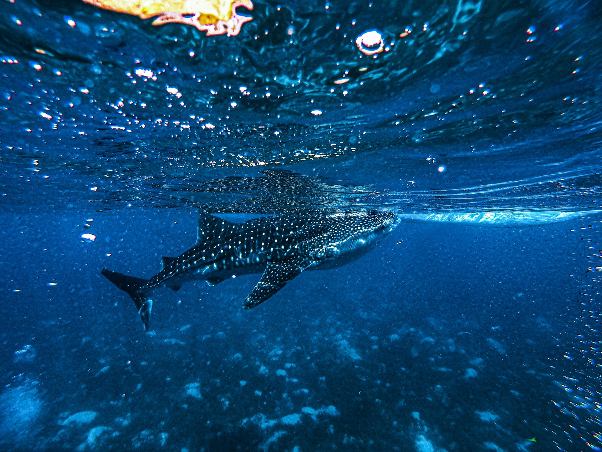

```{=html}
<style>
@import url('https://fonts.googleapis.com/css2?family=Inter:wght@400;500;600;700;800&display=swap');

body {
  font-family: 'Inter', -apple-system, BlinkMacSystemFont, "Segoe UI", Roboto, sans-serif;
  background-color: #f3f7fa;
  color: #1e293b;
}

#title-block-header {
  display: none !important;
}

#quarto-content.page-columns,
main.content.page-columns {
  display: block !important;
  width: 100% !important;
  max-width: 1100px !important;
  padding: 0 2rem 3rem 2rem !important;
  margin: 0 auto !important;
}

.hero-banner {
  background: #07192f;
  color: #ffffff;
  padding: 2.75rem 2.5rem;
  border-radius: 16px;
  margin: 1.5rem 0 1.75rem 0;
  box-shadow: 0 12px 30px rgba(7, 25, 47, 0.22);
  position: relative;
  overflow: hidden;
}

.hero-bg-img {
  position: absolute;
  inset: 0;
  width: 100%;
  height: 100%;
  object-fit: cover;
  object-position: center 52%;
  opacity: 0.62;
  pointer-events: none;
  z-index: 0;
}

.hero-banner::after {
  content: "";
  position: absolute;
  inset: 0;
  background: linear-gradient(100deg, rgba(7, 25, 47, 0.94) 0%, rgba(13, 59, 102, 0.80) 50%, rgba(13, 59, 102, 0.22) 100%);
  pointer-events: none;
  z-index: 1;
}

.hero-content {
  position: relative;
  z-index: 2;
  max-width: 680px;
}

.hero-eyebrow {
  display: inline-block;
  text-transform: uppercase;
  letter-spacing: 0.1em;
  font-size: 0.78rem;
  font-weight: 700;
  color: #7dd3fc;
  background: rgba(125, 211, 252, 0.12);
  border: 1px solid rgba(125, 211, 252, 0.3);
  padding: 0.3rem 0.75rem;
  border-radius: 999px;
  margin-bottom: 0.85rem;
}

.hero-title {
  font-size: 2.2rem;
  font-weight: 800;
  line-height: 1.2;
  margin: 0 0 0.5rem 0;
  color: #ffffff;
}

.hero-subtitle {
  font-size: 1.05rem;
  line-height: 1.6;
  color: #cbd5e1;
  margin: 0;
}

.info-card {
  background: #ffffff;
  border-radius: 14px;
  border: 1px solid #e2e8f0;
  box-shadow: 0 4px 16px rgba(15, 23, 42, 0.05);
  padding: 1.75rem 2rem;
  margin-bottom: 1.5rem;
}

.info-card h2 {
  margin-top: 0;
  color: #0f172a;
  font-weight: 700;
  font-size: 1.35rem;
  border-bottom: 2px solid #f1f5f9;
  padding-bottom: 0.6rem;
}

.split-card {
  display: grid;
  grid-template-columns: 1.35fr 0.85fr;
  background: #ffffff;
  border-radius: 16px;
  border: 1px solid #e2e8f0;
  box-shadow: 0 6px 20px rgba(15, 23, 42, 0.06);
  overflow: hidden;
  margin-bottom: 1.5rem;
}

.split-card-body {
  padding: 1.85rem 2rem;
}

.split-card-body h2 {
  margin-top: 0;
  color: #0f172a;
  font-weight: 700;
  font-size: 1.35rem;
  border-bottom: 2px solid #f1f5f9;
  padding-bottom: 0.6rem;
}

.split-card-media {
  position: relative;
  min-height: 300px;
  background: #07192f;
}

.split-card-media img {
  width: 100%;
  height: 100%;
  object-fit: cover;
  object-position: center 35%;
  display: block;
}

.split-card-caption {
  position: absolute;
  left: 0.85rem;
  right: 0.85rem;
  bottom: 0.85rem;
  background: rgba(7, 25, 47, 0.76);
  backdrop-filter: blur(6px);
  color: #e2e8f0;
  font-size: 0.78rem;
  line-height: 1.4;
  padding: 0.45rem 0.7rem;
  border-radius: 8px;
  border: 1px solid rgba(125, 211, 252, 0.22);
}

@media (max-width: 820px) {
  .split-card {
    grid-template-columns: 1fr;
  }
  .split-card-media {
    min-height: 240px;
  }
}
</style>

<div class="hero-banner">
  
  <div class="hero-content">
    <div class="hero-eyebrow">About &amp; Author</div>
    <h1 class="hero-title">About This Project</h1>
    <p class="hero-subtitle">
      Created by <strong>Gabriella Buccellato</strong> at <a href="https://www.ncf.edu/" target="_blank" rel="noopener" style="color:#7dd3fc;text-decoration:underline;">New College of Florida</a> — author background and data sources for the Coral Sea whale shark telemetry project.
    </p>
  </div>
</div>
```

<div class="info-card">

## Author & Project Information

- **Author:** Gabriella Buccellato
- **Contact:** [g.buccellato28@ncf.edu](mailto:g.buccellato28@ncf.edu)
- **GitHub Account:** [github.com/Gabbybee5](https://github.com/Gabbybee5)
- **Final Project Repository:** [https://github.com/Gabbybee5/whale-shark-trackings](https://github.com/Gabbybee5/whale-shark-trackings)
- **Institution:** [New College of Florida](https://www.ncf.edu/)

</div>

<div class="info-card">

## Primary Dataset

Miller, I. B., et al. (2025). The Needle in the Haystack: Uncovering the First Whale Shark (*Rhincodon typus*) Aggregation in the Coral Sea. *Ecology and Evolution*, 15, e71552.

- [Read the published research paper](https://doi.org/10.1002/ece3.71552)
- [Access the original CSIRO dataset](https://www.marine.csiro.au/ipt/resource?r=whale_shark_coral_sea)

Licensed under [Creative Commons Attribution 4.0](https://creativecommons.org/licenses/by/4.0/). Credit CSIRO and the original researchers when using it.

</div>

