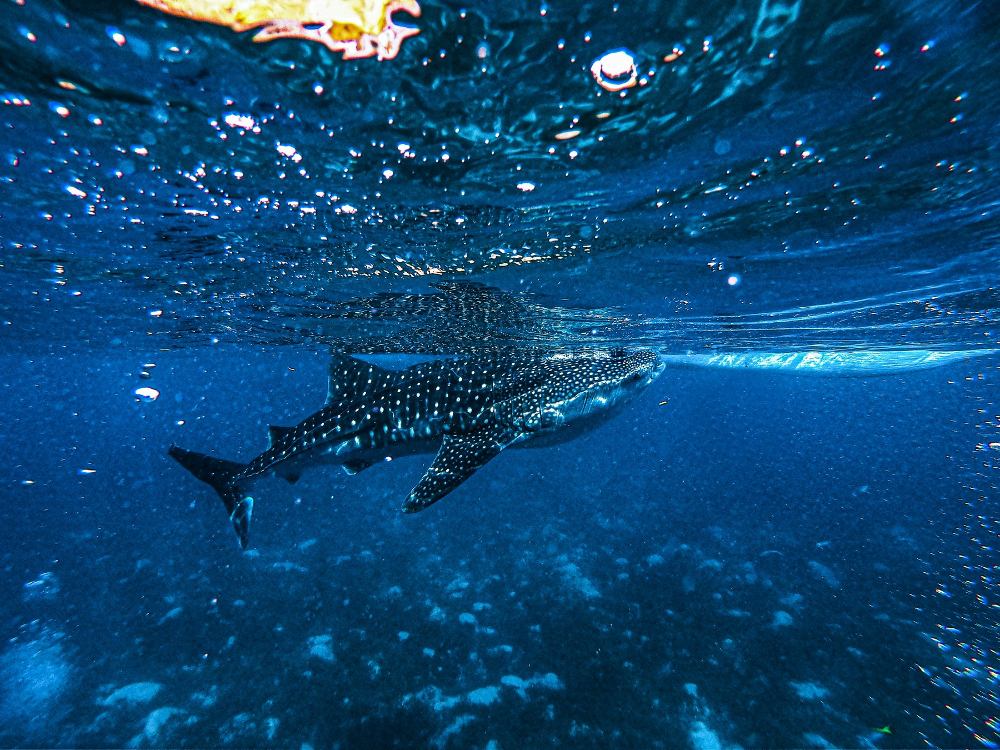

```{=html}
<style>
#title-block-header {
  display: none !important;
}

#quarto-content.page-columns,
main.content.page-columns {
  display: block !important;
  width: 100% !important;
  max-width: 1100px !important;
  padding: 0 2rem 3rem 2rem !important;
  margin: 0 auto !important;
}

.hero-banner {
  background: #07192f;
  color: #ffffff;
  padding: 2.75rem 2.5rem;
  border-radius: 16px;
  margin: 1.5rem 0 1.75rem 0;
  box-shadow: 0 14px 34px rgba(5, 15, 30, 0.3);
  position: relative;
  overflow: hidden;
  border: 1px solid var(--ocean-border, rgba(125, 211, 252, 0.24));
}

.hero-bg-img {
  position: absolute;
  inset: 0;
  width: 100%;
  height: 100%;
  object-fit: cover;
  object-position: center 50%;
  opacity: 0.62;
  pointer-events: none;
  z-index: 0;
}

.hero-banner::after {
  content: "";
  position: absolute;
  inset: 0;
  background: linear-gradient(100deg, rgba(7, 25, 47, 0.94) 0%, rgba(13, 59, 102, 0.80) 50%, rgba(15, 118, 110, 0.22) 100%);
  pointer-events: none;
  z-index: 1;
}

.hero-content {
  position: relative;
  z-index: 2;
  max-width: 760px;
}

.hero-eyebrow {
  display: inline-block;
  text-transform: uppercase;
  letter-spacing: 0.1em;
  font-size: 0.78rem;
  font-weight: 700;
  color: #7dd3fc;
  background: rgba(125, 211, 252, 0.12);
  border: 1px solid rgba(125, 211, 252, 0.3);
  padding: 0.3rem 0.75rem;
  border-radius: 999px;
  margin-bottom: 0.85rem;
}

.hero-title {
  font-size: 2.2rem;
  font-weight: 800;
  line-height: 1.2;
  margin: 0 0 0.5rem 0;
  color: #ffffff;
}

.hero-subtitle {
  font-size: 1.05rem;
  line-height: 1.6;
  color: #cbd5e1;
  margin: 0;
}

.info-card {
  background: linear-gradient(165deg, rgba(255, 255, 255, 0.08) 0%, var(--ocean-panel, rgba(9, 25, 46, 0.52)) 100%);
  border-radius: 16px;
  border: 1px solid var(--ocean-border, rgba(125, 211, 252, 0.24));
  box-shadow: 0 14px 34px rgba(5, 15, 30, 0.3);
  backdrop-filter: blur(16px);
  -webkit-backdrop-filter: blur(16px);
  padding: 1.75rem 2rem;
  margin-bottom: 1.5rem;
  color: var(--ocean-text, #f1f5f9);
}

.info-card h2 {
  margin-top: 0;
  color: #ffffff;
  font-weight: 700;
  font-size: 1.35rem;
  border-bottom: 1px solid rgba(148, 163, 184, 0.2);
  padding-bottom: 0.6rem;
}

.info-card p {
  color: #dbeafe;
  line-height: 1.6;
  font-size: 0.95rem;
  margin-bottom: 0.75rem;
}

.info-card ul {
  color: #dbeafe;
  line-height: 1.6;
  font-size: 0.93rem;
  margin: 0 0 0.75rem 0;
  padding-left: 1.25rem;
}

.info-card li {
  margin-bottom: 0.45rem;
}

.callout-pill {
  display: inline-block;
  font-size: 0.75rem;
  font-weight: 700;
  text-transform: uppercase;
  letter-spacing: 0.05em;
  padding: 0.22rem 0.65rem;
  border-radius: 999px;
  margin-bottom: 0.55rem;
}

.pill-habitat {
  background: rgba(45, 212, 191, 0.16);
  color: var(--ocean-turquoise, #2dd4bf);
  border: 1px solid rgba(45, 212, 191, 0.4);
}

.pill-transboundary {
  background: rgba(34, 211, 238, 0.16);
  color: var(--ocean-cyan, #22d3ee);
  border: 1px solid rgba(34, 211, 238, 0.4);
}

.pill-caution {
  background: rgba(255, 133, 115, 0.16);
  color: var(--ocean-coral, #ff8573);
  border: 1px solid rgba(255, 133, 115, 0.4);
}

details.ocean-expandable {
  margin-top: 1.15rem;
  background: rgba(7, 20, 38, 0.65);
  border: 1px solid rgba(125, 211, 252, 0.22);
  border-radius: 12px;
  padding: 0.85rem 1.15rem;
  transition: all 0.25s ease;
}

details.ocean-expandable[open] {
  background: rgba(7, 20, 38, 0.85);
  border-color: rgba(34, 211, 238, 0.4);
}

details.ocean-expandable summary {
  font-weight: 700;
  font-size: 0.92rem;
  color: var(--ocean-cyan, #22d3ee);
  cursor: pointer;
  display: flex;
  align-items: center;
  gap: 0.5rem;
  list-style: none;
  user-select: none;
}

details.ocean-expandable summary::-webkit-details-marker {
  display: none;
}

details.ocean-expandable summary::before {
  content: "▸";
  display: inline-block;
  font-size: 0.9rem;
  transition: transform 0.2s ease;
  color: var(--ocean-cyan, #22d3ee);
}

details.ocean-expandable[open] summary::before {
  transform: rotate(90deg);
}

.expandable-content {
  margin-top: 0.85rem;
  padding-top: 0.85rem;
  border-top: 1px solid rgba(148, 163, 184, 0.2);
  font-size: 0.9rem;
  line-height: 1.6;
  color: #cbd5e1;
}

.expandable-content p {
  color: #cbd5e1;
  font-size: 0.9rem;
  margin-bottom: 0.5rem;
}

.expandable-content ul {
  margin: 0;
  padding-left: 1.25rem;
  color: #cbd5e1;
}

.expandable-content li {
  margin-bottom: 0.45rem;
}
</style>

<div class="hero-banner">
  
  <div class="hero-content">
    <div class="hero-eyebrow">Ecological &amp; Conservation Context</div>
    <h1 class="hero-title">Whale Shark Ecology &amp; Conservation in the Coral Sea</h1>
    <p class="hero-subtitle">
      Satellite telemetry and marine ecological research: feeding aggregations, transboundary migrations, and conservation priorities.
    </p>
  </div>
</div>
```

<div class="info-card">

<span class="callout-pill pill-habitat">Theme 1</span>

## Important Habitats

- **Tracking Observation:** Tagged sharks and sightings clustered at Wreck Bay (12.1°S–12.2°S) during austral summer (November–February), dominated by immature and subadult males.
- **Scientific Interpretation:** Wreck Bay is eastern Australia's first confirmed aggregation site, where young sharks assemble to exploit seasonal coral and fish spawning prey pulses for growth.

```{=html}
<details class="ocean-expandable">
  <summary>🔬 Scientific Details: Diving &amp; Surface Thermoregulation</summary>
  <div class="expandable-content">
    <p>
      Whale sharks dive into deep, cold water (>1,000 m) to forage, returning to the warm surface mixed layer to bask ("behavioral thermoregulation"), which exposes fin-mounted tags to transmit satellite uplinks.
    </p>
  </div>
</details>
```

</div>

<div class="info-card">

<span class="callout-pill pill-transboundary">Theme 2</span>

## International Movements

- **Tracking Observation:** Satellite tracks crossed international boundaries and deep ocean basins, including Ali traveling ~11,378 km into Papua New Guinea waters and GBR1 reaching 6.3°S in the Solomon Sea.
- **Scientific Interpretation:** Whale sharks operate on oceanic scales beyond national borders, requiring continuous migratory corridors across geopolitical jurisdictions.

```{=html}
<details class="ocean-expandable">
  <summary>🌐 Scientific Details: Jurisdictional Gaps &amp; International Treaties</summary>
  <div class="expandable-content">
    <ul>
      <li><strong>Jurisdictional Disconnect:</strong> Sharks protected inside Australian marine parks lose legal protection when entering unmanaged high seas or foreign waters.</li>
      <li><strong>Multilateral Treaties:</strong> Transboundary movements require international cooperation under <strong>CMS Appendix I/II</strong> (protecting migratory ranges) and <strong>CITES Appendix II</strong> (regulating trade).</li>
    </ul>
  </div>
</details>
```

</div>

<div class="info-card">

<span class="callout-pill pill-caution">Theme 3</span>

## Conservation

- **Tracking Observation:** Telemetry pinpoints predictable seasonal aggregation timing, surface residency zones, and open-ocean migratory corridors.
- **Scientific Interpretation:** For an Endangered species with >50% global decline, tracking data enables targeted marine park zoning, vessel speed restrictions, and eco-tourism guidelines.

```{=html}
<details class="ocean-expandable">
  <summary>⚠️ Scientific Details: Key Anthropogenic Threats</summary>
  <div class="expandable-content">
    <ul>
      <li><strong>Vessel Strikes:</strong> Surface swimming and basking in shipping lanes make whale sharks vulnerable to commercial ship collisions.</li>
      <li><strong>Bycatch &amp; Fishing Gear:</strong> Tuna schools aggregate beneath whale sharks, risking entanglement in purse-seine nets and ghost gear.</li>
      <li><strong>Disturbance &amp; Climate Shifts:</strong> Shipping noise and diver crowding disrupt habitats, while warming seas alter plankton bloom timing.</li>
    </ul>
  </div>
</details>
```

</div>
