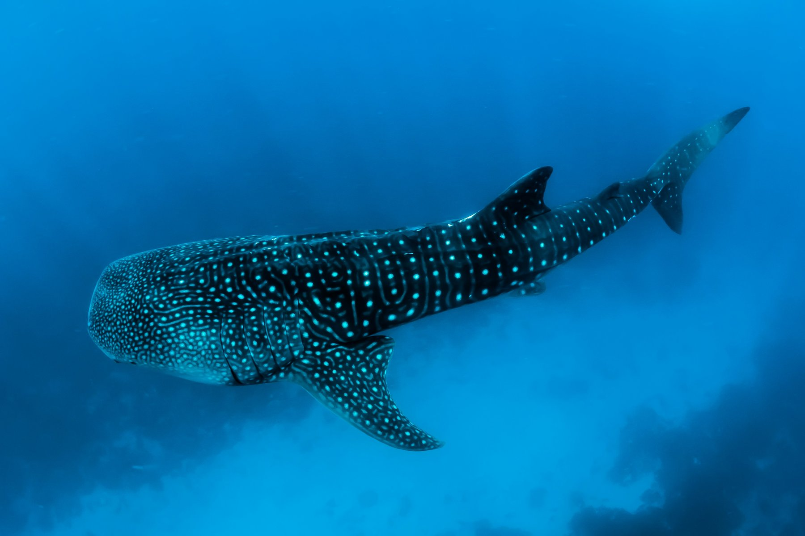

```{=html}
<style>
@import url('https://fonts.googleapis.com/css2?family=Inter:wght@400;500;600;700;800&display=swap');

body {
  font-family: 'Inter', -apple-system, BlinkMacSystemFont, "Segoe UI", Roboto, sans-serif;
  background-color: #f3f7fa;
  color: #1e293b;
}

#title-block-header {
  display: none !important;
}

#quarto-content.page-columns,
main.content.page-columns {
  display: block !important;
  width: 100% !important;
  max-width: 1100px !important;
  padding: 0 2rem 3rem 2rem !important;
  margin: 0 auto !important;
}

.hero-banner {
  background: #07192f;
  color: #ffffff;
  padding: 2.75rem 2.5rem;
  border-radius: 16px;
  margin: 1.5rem 0 1.75rem 0;
  box-shadow: 0 12px 30px rgba(7, 25, 47, 0.22);
  position: relative;
  overflow: hidden;
}

.hero-bg-img {
  position: absolute;
  inset: 0;
  width: 100%;
  height: 100%;
  object-fit: cover;
  object-position: 35% 52%;
  opacity: 0.62;
  pointer-events: none;
  z-index: 0;
  transform: scaleX(-1);
}

.hero-banner::after {
  content: "";
  position: absolute;
  inset: 0;
  background: linear-gradient(100deg, rgba(7, 25, 47, 0.95) 0%, rgba(13, 59, 102, 0.82) 52%, rgba(15, 118, 110, 0.22) 100%);
  pointer-events: none;
  z-index: 1;
}

.hero-content {
  position: relative;
  z-index: 2;
  max-width: 720px;
}

.hero-eyebrow {
  display: inline-block;
  text-transform: uppercase;
  letter-spacing: 0.1em;
  font-size: 0.78rem;
  font-weight: 700;
  color: #7dd3fc;
  background: rgba(125, 211, 252, 0.12);
  border: 1px solid rgba(125, 211, 252, 0.3);
  padding: 0.3rem 0.75rem;
  border-radius: 999px;
  margin-bottom: 0.85rem;
}

.hero-title {
  font-size: 2.2rem;
  font-weight: 800;
  line-height: 1.2;
  margin: 0 0 0.5rem 0;
  color: #ffffff;
}

.hero-subtitle {
  font-size: 1.05rem;
  line-height: 1.6;
  color: #cbd5e1;
  margin: 0;
}

.info-card {
  background: #ffffff;
  border-radius: 14px;
  border: 1px solid #e2e8f0;
  box-shadow: 0 4px 16px rgba(15, 23, 42, 0.05);
  padding: 1.75rem 2rem;
  margin-bottom: 1.5rem;
}

.info-card h2 {
  margin-top: 0;
  color: #0f172a;
  font-weight: 700;
  font-size: 1.35rem;
  border-bottom: 2px solid #f1f5f9;
  padding-bottom: 0.6rem;
}

.data-table {
  width: 100%;
  border-collapse: collapse;
  margin-top: 0.75rem;
  font-size: 0.94rem;
}

.data-table th, .data-table td {
  text-align: left;
  padding: 0.65rem 0.85rem;
  border-bottom: 1px solid #e2e8f0;
}

.data-table th {
  background-color: #f8fafc;
  color: #0f172a;
  font-weight: 700;
}

.shark-deck-nav {
  display: flex;
  justify-content: space-between;
  align-items: center;
  flex-wrap: wrap;
  gap: 0.6rem;
  margin: 0.9rem 0 0.75rem 0;
}

.deck-counter {
  font-size: 0.88rem;
  font-weight: 700;
  color: #475569;
}

.deck-actions {
  display: flex;
  align-items: center;
  gap: 0.45rem;
}

.action-btn {
  font-family: inherit;
  font-size: 0.82rem;
  font-weight: 600;
  border-radius: 999px;
  padding: 0.38rem 0.85rem;
  cursor: pointer;
  transition: all 0.15s ease;
  border: 1px solid #cbd5e1;
  background: #ffffff;
  color: #334155;
}

.action-btn:hover {
  background: #f1f5f9;
  border-color: #94a3b8;
  color: #0f172a;
}

.action-btn.surprise-btn {
  background: #f0fdfa;
  color: #0f766e;
  border-color: #99f6e4;
}

.action-btn.surprise-btn:hover {
  background: #ccfbf1;
}

.shark-selector-bar {
  display: flex;
  flex-wrap: wrap;
  gap: 0.4rem;
  margin: 0 0 1.25rem 0;
  padding-bottom: 1rem;
  border-bottom: 1px solid #e2e8f0;
}

.shark-pill {
  font-family: inherit;
  font-size: 0.84rem;
  font-weight: 600;
  color: #334155;
  background: #f8fafc;
  border: 1px solid #cbd5e1;
  border-radius: 999px;
  padding: 0.35rem 0.8rem;
  cursor: pointer;
  transition: all 0.15s ease-in-out;
}

.shark-pill:hover {
  background: #e2e8f0;
  color: #0f172a;
}

.shark-pill.active {
  background: linear-gradient(135deg, #0d3b66 0%, #0f766e 100%);
  color: #ffffff;
  border-color: #0d3b66;
}

.shark-cards-stage {
  display: grid;
  grid-template-columns: 1fr;
  gap: 1.15rem;
}

.shark-cards-stage.grid-all-mode {
  grid-template-columns: repeat(2, 1fr);
}

.shark-subsection {
  display: none;
  background: #ffffff;
  border: 1px solid #e2e8f0;
  border-top: 4px solid #0f766e;
  border-radius: 14px;
  padding: 1.4rem 1.6rem;
  box-shadow: 0 4px 14px rgba(15, 23, 42, 0.04);
  animation: fadeSlideIn 0.22s ease-out;
}

@keyframes fadeSlideIn {
  from { opacity: 0; transform: translateY(4px); }
  to { opacity: 1; transform: translateY(0); }
}

.shark-subsection.visible {
  display: block;
}

.shark-card-header {
  display: flex;
  justify-content: space-between;
  align-items: flex-start;
  gap: 0.75rem;
  margin-bottom: 0.75rem;
}

.shark-identity {
  display: flex;
  align-items: center;
  gap: 0.8rem;
}

.shark-avatar {
  width: 44px;
  height: 44px;
  border-radius: 12px;
  background: linear-gradient(135deg, #0d3b66 0%, #0f766e 100%);
  display: flex;
  align-items: center;
  justify-content: center;
  flex-shrink: 0;
}

.shark-subsection h3 {
  margin: 0;
  font-size: 1.2rem;
  font-weight: 800;
  color: #0f172a;
}

.fav-btn {
  font-family: inherit;
  font-size: 0.8rem;
  font-weight: 600;
  border-radius: 999px;
  padding: 0.3rem 0.7rem;
  border: 1px solid #e2e8f0;
  background: #ffffff;
  color: #64748b;
  cursor: pointer;
  transition: all 0.15s ease;
  white-space: nowrap;
}

.fav-btn:hover {
  border-color: #fda4af;
  color: #e11d48;
  background: #fff1f2;
}

.fav-btn.favorited {
  background: #fff1f2;
  border-color: #fecdd3;
  color: #e11d48;
}

.shark-meta {
  display: flex;
  flex-wrap: wrap;
  gap: 0.45rem;
  margin-bottom: 1rem;
}

/* Hide middle 3 chips since they are displayed cleanly in the visual stat bars */
.shark-meta .meta-chip.stat-chip-hidden {
  display: none;
}

.meta-chip {
  font-size: 0.78rem;
  font-weight: 600;
  background: #f1f5f9;
  border: 1px solid #dbe4ee;
  color: #334155;
  padding: 0.24rem 0.68rem;
  border-radius: 999px;
}

.shark-meters {
  display: grid;
  grid-template-columns: repeat(3, 1fr);
  gap: 0.85rem;
  background: #f8fafc;
  border: 1px solid #e2e8f0;
  border-radius: 12px;
  padding: 0.85rem 1rem;
  margin-bottom: 1rem;
}

.meter-box {
  display: flex;
  flex-direction: column;
  gap: 0.3rem;
}

.meter-label {
  font-size: 0.72rem;
  font-weight: 700;
  text-transform: uppercase;
  letter-spacing: 0.04em;
  color: #64748b;
}

.meter-val {
  font-size: 0.84rem;
  font-weight: 700;
  color: #0f172a;
}

.meter-track {
  height: 7px;
  background: #e2e8f0;
  border-radius: 999px;
  overflow: hidden;
  margin-top: 0.1rem;
}

.meter-fill {
  height: 100%;
  width: 0%;
  border-radius: 999px;
  background: linear-gradient(90deg, #0284c7 0%, #0f766e 100%);
  transition: width 0.45s cubic-bezier(0.22, 1, 0.36, 1);
}

.shark-subsection ul {
  margin: 0;
  padding-left: 0;
  list-style: none;
  display: grid;
  grid-template-columns: repeat(2, 1fr);
  gap: 0.85rem;
}

.shark-cards-stage.grid-all-mode .shark-subsection ul {
  grid-template-columns: 1fr;
}

.shark-subsection li {
  background: #f8fafc;
  border: 1px solid #e2e8f0;
  border-left: 3px solid #0284c7;
  border-radius: 10px;
  padding: 0.8rem 0.95rem;
  margin: 0;
  line-height: 1.55;
  font-size: 0.93rem;
}

.shark-subsection li:last-child {
  border-left-color: #0f766e;
}

.seasonal-grid {
  display: grid;
  grid-template-columns: repeat(2, 1fr);
  gap: 1.5rem;
  margin-bottom: 1.5rem;
}

.seasonal-grid .info-card {
  margin-bottom: 0;
  height: 100%;
}

@media (max-width: 780px) {
  .seasonal-grid,
  .shark-cards-stage.grid-all-mode,
  .shark-meters,
  .shark-subsection ul {
    grid-template-columns: 1fr;
  }
}
</style>
<script>
const SHARK_ORDER = [
  'megashark', 'alexios', 'ali', 'sharpie', 'juanita', 'gbr1',
  'beizam', 'blancpain', 'gbr2', 'infamis', 'jaap', 'halliday',
  'hugh', 'fifty_fathoms', 'sapphire', 'andrew', 'dotti', 'ambitious'
];

const AVATAR_GRADIENTS = [
  'linear-gradient(135deg, #0d3b66 0%, #0f766e 100%)',
  'linear-gradient(135deg, #0369a1 0%, #0d9488 100%)',
  'linear-gradient(135deg, #1e3a8a 0%, #0284c7 100%)',
  'linear-gradient(135deg, #115e59 0%, #0369a1 100%)',
  'linear-gradient(135deg, #0f172a 0%, #0e7490 100%)',
  'linear-gradient(135deg, #1d4ed8 0%, #0f766e 100%)'
];

let currentSharkId = 'megashark';
let favoriteSharks = new Set();

try {
  const saved = JSON.parse(localStorage.getItem('ws_favorites') || '[]');
  if (Array.isArray(saved)) favoriteSharks = new Set(saved);
} catch (e) {}

function whaleSharkSvg() {
  return `<svg width="28" height="28" viewBox="0 0 64 64" fill="none" xmlns="http://www.w3.org/2000/svg" aria-hidden="true">
    <path d="M8 33C14 23 27 19 42 22C49 23.5 54 20 58 15C57 22 55 27 56 32C55 37 57 42 58 49C54 44 49 40.5 42 42C27 45 14 41 8 33Z" fill="#e0f2fe"/>
    <path d="M29 21L34 11L38 21.5" fill="#bae6fd"/>
    <path d="M24 41L29 51L34 42" fill="#7dd3fc"/>
    <circle cx="15" cy="31" r="1.8" fill="#0f172a"/>
    <circle cx="24" cy="28" r="1.5" fill="#0284c7"/>
    <circle cx="29" cy="31" r="1.4" fill="#0284c7"/>
    <circle cx="25" cy="35" r="1.4" fill="#0284c7"/>
    <circle cx="34" cy="27" r="1.5" fill="#0284c7"/>
    <circle cx="35" cy="33" r="1.5" fill="#0284c7"/>
  </svg>`;
}

function syncPillHearts() {
  document.querySelectorAll('.shark-pill').forEach(function(btn) {
    const sid = btn.getAttribute('data-shark');
    const baseName = btn.getAttribute('data-label');
    if (!sid || !baseName || sid === 'all') return;
    btn.textContent = favoriteSharks.has(sid) ? '❤️ ' + baseName : baseName;
  });
}

function updateCounter() {
  const counter = document.getElementById('deck-counter');
  if (!counter) return;
  if (currentSharkId === 'all') {
    counter.textContent = 'Showing all 18 Whale Sharks';
  } else {
    const idx = SHARK_ORDER.indexOf(currentSharkId);
    counter.textContent = 'Whale Shark ' + (idx + 1) + ' of ' + SHARK_ORDER.length;
  }
}

function animateVisibleMeters() {
  document.querySelectorAll('.shark-subsection.visible .meter-fill').forEach(function(bar) {
    const target = bar.getAttribute('data-target') || '0%';
    bar.style.width = '0%';
    requestAnimationFrame(function() {
      requestAnimationFrame(function() {
        bar.style.width = target;
      });
    });
  });
}

function selectShark(sharkId, btnEl) {
  currentSharkId = sharkId;
  document.querySelectorAll('.shark-pill').forEach(function(btn) {
    btn.classList.toggle('active', btn.getAttribute('data-shark') === sharkId);
  });
  if (btnEl) btnEl.classList.add('active');

  const stage = document.getElementById('shark-cards-stage');
  if (stage) {
    stage.classList.toggle('grid-all-mode', sharkId === 'all');
  }

  document.querySelectorAll('.shark-subsection').forEach(function(sec) {
    const sid = sec.id.replace('shark-', '');
    sec.classList.toggle('visible', sharkId === 'all' || sid === sharkId);
  });

  updateCounter();
  animateVisibleMeters();
}

function stepShark(delta) {
  let idx = SHARK_ORDER.indexOf(currentSharkId);
  if (idx === -1) idx = 0;
  else idx = (idx + delta + SHARK_ORDER.length) % SHARK_ORDER.length;
  selectShark(SHARK_ORDER[idx]);
}

function surpriseShark() {
  const candidates = SHARK_ORDER.filter(function(id) { return id !== currentSharkId; });
  const pick = candidates[Math.floor(Math.random() * candidates.length)];
  selectShark(pick);
}

function toggleFavorite(sharkId, btnEl) {
  if (favoriteSharks.has(sharkId)) {
    favoriteSharks.delete(sharkId);
  } else {
    favoriteSharks.add(sharkId);
  }
  const isFav = favoriteSharks.has(sharkId);
  btnEl.classList.toggle('favorited', isFav);
  btnEl.innerHTML = isFav ? '❤️ Favorited' : '🤍 Favorite';
  try {
    localStorage.setItem('ws_favorites', JSON.stringify(Array.from(favoriteSharks)));
  } catch (e) {}
  syncPillHearts();
}

document.addEventListener('DOMContentLoaded', function() {
  document.querySelectorAll('.shark-pill').forEach(function(btn) {
    const m = (btn.getAttribute('onclick') || '').match(/selectShark\('([^']+)'/);
    if (m) {
      btn.setAttribute('data-shark', m[1]);
      btn.setAttribute('data-label', btn.textContent.trim());
    }
  });

  document.querySelectorAll('.shark-subsection').forEach(function(sec, idx) {
    const sid = sec.id.replace('shark-', '');
    const h3 = sec.querySelector('h3');
    const chips = sec.querySelectorAll('.meta-chip');

    const pingsText = chips[1] ? chips[1].textContent.trim() : '';
    const spanText = chips[2] ? chips[2].textContent.replace(/^Span:\s*/, '').trim() : '';
    const distText = chips[3] ? chips[3].textContent.replace(/^Min\.\s*Distance:\s*/, '').trim() : '';

    if (chips[1]) chips[1].classList.add('stat-chip-hidden');
    if (chips[2]) chips[2].classList.add('stat-chip-hidden');
    if (chips[3]) chips[3].classList.add('stat-chip-hidden');

    const pingsMatch = pingsText.match(/(\d+)/);
    const monthsMatch = spanText.match(/^([\d.]+)/);
    const kmMatch = distText.match(/~?([\d,]+)\s*km/);

    const pings = pingsMatch ? Number(pingsMatch[1]) : 0;
    const months = monthsMatch ? Number(monthsMatch[1]) : 0;
    const km = kmMatch ? Number(kmMatch[1].replace(/,/g, '')) : 0;

    if (h3) {
      const header = document.createElement('div');
      header.className = 'shark-card-header';

      const identity = document.createElement('div');
      identity.className = 'shark-identity';

      const avatar = document.createElement('div');
      avatar.className = 'shark-avatar';
      avatar.style.background = AVATAR_GRADIENTS[idx % AVATAR_GRADIENTS.length];
      avatar.innerHTML = whaleSharkSvg();

      h3.parentNode.insertBefore(header, h3);
      identity.appendChild(avatar);
      identity.appendChild(h3);
      header.appendChild(identity);

      const favBtn = document.createElement('button');
      favBtn.type = 'button';
      const isFav = favoriteSharks.has(sid);
      favBtn.className = 'fav-btn' + (isFav ? ' favorited' : '');
      favBtn.innerHTML = isFav ? '❤️ Favorited' : '🤍 Favorite';
      favBtn.onclick = function() { toggleFavorite(sid, favBtn); };
      header.appendChild(favBtn);
    }

    const pingPct = Math.max(5, Math.min(100, Math.round((pings / 423) * 100)));
    const monthPct = Math.max(5, Math.min(100, Math.round((months / 25.3) * 100)));
    const kmPct = Math.max(5, Math.min(100, Math.round((km / 11378) * 100)));

    const meters = document.createElement('div');
    meters.className = 'shark-meters';
    meters.innerHTML = `
      <div class="meter-box">
        <span class="meter-label">Transmissions</span>
        <span class="meter-val">${pingsText}</span>
        <div class="meter-track"><div class="meter-fill" data-target="${pingPct}%"></div></div>
      </div>
      <div class="meter-box">
        <span class="meter-label">Tracking Span</span>
        <span class="meter-val">${spanText}</span>
        <div class="meter-track"><div class="meter-fill" data-target="${monthPct}%"></div></div>
      </div>
      <div class="meter-box">
        <span class="meter-label">Min. Distance</span>
        <span class="meter-val">${distText}</span>
        <div class="meter-track"><div class="meter-fill" data-target="${kmPct}%"></div></div>
      </div>
    `;

    const ul = sec.querySelector('ul');
    if (ul) sec.insertBefore(meters, ul);
  });

  syncPillHearts();
  updateCounter();
  animateVisibleMeters();
});
</script>

<div class="hero-banner">
  
  <div class="hero-content">
    <div class="hero-eyebrow">Key Findings & Graph Breakdown</div>
    <h1 class="hero-title">Discover the Profiles of Each Individual Whale Shark Tracked</h1>
    <p class="hero-subtitle">
      This project analyzes 2,391 whale shark (<em>Rhincodon typus</em>) observations in Australia's Coral Sea collected by the Biopixel Oceans Foundation and James Cook University. The dataset combines 2,255 satellite transmissions from 18 individually named sharks along the Great Barrier Reef and Coral Sea reefs with 136 opportunistic sightings recorded from 2007 to 2018. Explore the profiles below to see each shark's trajectory, deep-water plateaus, and seasonal surges.
    </p>
  </div>
</div>
```

<div class="info-card">

## Ecological Patterns in the Plot — By Named Whale Shark

Pick any whale shark below, flip through with **Previous / Next**, or try **🎲 Random Shark** to meet each individual:

```{=html}
<div class="shark-deck-nav">
  <span id="deck-counter" class="deck-counter">Whale Shark 1 of 18</span>
  <div class="deck-actions">
    <button type="button" class="action-btn" onclick="stepShark(-1)">◀ Previous</button>
    <button type="button" class="action-btn surprise-btn" onclick="surpriseShark()">🎲 Random Shark</button>
    <button type="button" class="action-btn" onclick="stepShark(1)">Next ▶</button>
  </div>
</div>

<div class="shark-selector-bar">
  <button class="shark-pill active" onclick="selectShark('megashark', this)">Megashark</button>
  <button class="shark-pill" onclick="selectShark('alexios', this)">Alexios</button>
  <button class="shark-pill" onclick="selectShark('ali', this)">Ali</button>
  <button class="shark-pill" onclick="selectShark('sharpie', this)">Sharpie</button>
  <button class="shark-pill" onclick="selectShark('juanita', this)">Juanita</button>
  <button class="shark-pill" onclick="selectShark('gbr1', this)">GBR1</button>
  <button class="shark-pill" onclick="selectShark('beizam', this)">Beizam</button>
  <button class="shark-pill" onclick="selectShark('blancpain', this)">Blancpain</button>
  <button class="shark-pill" onclick="selectShark('gbr2', this)">GBR2</button>
  <button class="shark-pill" onclick="selectShark('infamis', this)">Infamis</button>
  <button class="shark-pill" onclick="selectShark('jaap', this)">Jaap</button>
  <button class="shark-pill" onclick="selectShark('halliday', this)">Halliday</button>
  <button class="shark-pill" onclick="selectShark('hugh', this)">Hugh</button>
  <button class="shark-pill" onclick="selectShark('fifty_fathoms', this)">Fifty_Fathoms</button>
  <button class="shark-pill" onclick="selectShark('sapphire', this)">Sapphire</button>
  <button class="shark-pill" onclick="selectShark('andrew', this)">Andrew</button>
  <button class="shark-pill" onclick="selectShark('dotti', this)">Dotti</button>
  <button class="shark-pill" onclick="selectShark('ambitious', this)">Ambitious</button>
  <button class="shark-pill" onclick="selectShark('all', this)">Show All 18</button>
</div>

<div id="shark-cards-stage" class="shark-cards-stage">

<div id="shark-megashark" class="shark-subsection visible">
  <h3>Megashark (Tag ID: 252324)</h3>
  <div class="shark-meta">
    <span class="meta-chip">Male · Immature</span>
    <span class="meta-chip">423 Transmissions</span>
    <span class="meta-chip">Span: 13.0 Months (2023-11-30 to 2024-12-31)</span>
    <span class="meta-chip">Min. Distance: ~6,073 km</span>
    <span class="meta-chip">Latitudes: 16.5°S to 9.7°S</span>
  </div>
  <ul>
    <li><strong>Curve Pattern on Plot:</strong> Forms the tallest trajectory on the scatter plot (reaching 423 cumulative detections). After climbing steeply over its first few summer months, it flattens across a 49-day mid-year gap before surging strongly again between Months 10 and 13.</li>
    <li><strong>Ecological Takeaway:</strong> Shows classic seasonal cycling — frequent surface foraging during back-to-back austral summers separated by deeper offshore winter roaming across more than 6,000 km of the Coral Sea.</li>
  </ul>
</div>

<div id="shark-alexios" class="shark-subsection">
  <h3>Alexios (Tag ID: 178953)</h3>
  <div class="shark-meta">
    <span class="meta-chip">Male · Immature</span>
    <span class="meta-chip">357 Transmissions</span>
    <span class="meta-chip">Span: 5.2 Months (2021-12-05 to 2022-05-12)</span>
    <span class="meta-chip">Min. Distance: ~4,307 km</span>
    <span class="meta-chip">Latitudes: 18.1°S to 11.1°S</span>
  </div>
  <ul>
    <li><strong>Curve Pattern on Plot:</strong> Rises rapidly and smoothly to 357 detections in just over 5 months (~2.3 transmissions/day) with no silent gap longer than 13 days.</li>
    <li><strong>Ecological Takeaway:</strong> Indicates sustained surface and upper-water-column activity as this immature male traveled over 4,300 km along the outer Great Barrier Reef and Coral Sea basin from summer into autumn.</li>
  </ul>
</div>

<div id="shark-ali" class="shark-subsection">
  <h3>Ali (Tag ID: 178954)</h3>
  <div class="shark-meta">
    <span class="meta-chip">Female · Immature</span>
    <span class="meta-chip">273 Transmissions</span>
    <span class="meta-chip">Span: 25.3 Months (2021-12-06 to 2024-01-15)</span>
    <span class="meta-chip">Min. Distance: ~11,378 km</span>
    <span class="meta-chip">Latitudes: 18.6°S to 7.9°S</span>
  </div>
  <ul>
    <li><strong>Curve Pattern on Plot:</strong> Stretches farthest right among all tagged sharks (25.3 months / >2 years), advancing in staircase-like seasonal bursts separated by gaps of up to 73 days.</li>
    <li><strong>Ecological Takeaway:</strong> One of only two confirmed females in the tagged cohort and the dataset's long-distance marathoner, logging over 11,300 km between central Queensland latitudes and waters near Papua New Guinea.</li>
  </ul>
</div>

<div id="shark-sharpie" class="shark-subsection">
  <h3>Sharpie (Tag ID: 252325)</h3>
  <div class="shark-meta">
    <span class="meta-chip">Male · Immature</span>
    <span class="meta-chip">261 Transmissions</span>
    <span class="meta-chip">Span: 3.2 Months (2023-12-01 to 2024-03-07)</span>
    <span class="meta-chip">Min. Distance: ~1,544 km</span>
    <span class="meta-chip">Latitudes: 13.5°S to 11.3°S</span>
  </div>
  <ul>
    <li><strong>Curve Pattern on Plot:</strong> One of the steepest initial slopes on the chart, packing 261 locations into 97 days (~2.7 uplinks/day) with a maximum gap of only 10 days.</li>
    <li><strong>Ecological Takeaway:</strong> Stayed within a relatively tight northern reef band (11.3°S–13.5°S), spending long periods basking and filter-feeding at the surface during peak summer plankton productivity.</li>
  </ul>
</div>

<div id="shark-juanita" class="shark-subsection">
  <h3>Juanita (Tag ID: 172900)</h3>
  <div class="shark-meta">
    <span class="meta-chip">Unknown Sex · Immature</span>
    <span class="meta-chip">204 Transmissions</span>
    <span class="meta-chip">Span: 4.3 Months (2023-11-03 to 2024-03-14)</span>
    <span class="meta-chip">Min. Distance: ~2,642 km</span>
    <span class="meta-chip">Latitudes: 16.6°S to 8.1°S</span>
  </div>
  <ul>
    <li><strong>Curve Pattern on Plot:</strong> Climbs steadily from Month 0 to 204 detections across 4.3 months, punctuated by brief 1–3 week pauses (max gap 21 days).</li>
    <li><strong>Ecological Takeaway:</strong> Tracked earlier in spring (early November) than most sharks and ranged widely across 8.5 degrees of latitude northward into the northern Coral Sea.</li>
  </ul>
</div>

<div id="shark-gbr1" class="shark-subsection">
  <h3>GBR1 (Tag ID: 172899)</h3>
  <div class="shark-meta">
    <span class="meta-chip">Unknown Sex · Immature</span>
    <span class="meta-chip">177 Transmissions</span>
    <span class="meta-chip">Span: 4.8 Months (2018-10-26 to 2019-03-21)</span>
    <span class="meta-chip">Min. Distance: ~3,677 km</span>
    <span class="meta-chip">Latitudes: 14.2°S to 6.3°S</span>
  </div>
  <ul>
    <li><strong>Curve Pattern on Plot:</strong> Exceptionally smooth, unbroken upward line over nearly 5 months — never going more than 4 days without a satellite uplink.</li>
    <li><strong>Ecological Takeaway:</strong> Reached the northernmost latitude of any shark in the dataset (6.3°S in Papua New Guinea waters), proving cross-border movement across the northern Coral Sea.</li>
  </ul>
</div>

<div id="shark-beizam" class="shark-subsection">
  <h3>Beizam (Tag ID: 243952)</h3>
  <div class="shark-meta">
    <span class="meta-chip">Male · Subadult</span>
    <span class="meta-chip">98 Transmissions</span>
    <span class="meta-chip">Span: 2.2 Months (2023-12-02 to 2024-02-08)</span>
    <span class="meta-chip">Min. Distance: ~1,846 km</span>
    <span class="meta-chip">Latitudes: 17.2°S to 11.3°S</span>
  </div>
  <ul>
    <li><strong>Curve Pattern on Plot:</strong> Steady 2.2-month climb to 98 detections across December–February with minimal transmission gaps.</li>
    <li><strong>Ecological Takeaway:</strong> Notable as the <strong>only Subadult</strong> shark in an otherwise immature-dominated tagged group, cruising rapidly southward and offshore (~27 km/day) across nearly 6 degrees of latitude.</li>
  </ul>
</div>

<div id="shark-blancpain" class="shark-subsection">
  <h3>Blancpain (Tag ID: 178957)</h3>
  <div class="shark-meta">
    <span class="meta-chip">Female · Immature</span>
    <span class="meta-chip">73 Transmissions</span>
    <span class="meta-chip">Span: 17.3 Months (2021-12-06 to 2023-05-16)</span>
    <span class="meta-chip">Min. Distance: ~1,943 km</span>
    <span class="meta-chip">Latitudes: 14.5°S to 8.1°S</span>
  </div>
  <ul>
    <li><strong>Curve Pattern on Plot:</strong> Features the most dramatic horizontal plateau on the entire plot — going silent for <strong>276 consecutive days (~9 months)</strong> before resuming transmissions past Month 15.</li>
    <li><strong>Ecological Takeaway:</strong> Along with <em>Ali</em>, one of only two tagged females; demonstrates how whale sharks can spend months foraging in deep or remote waters without long surface intervals before reappearing the next season.</li>
  </ul>
</div>

<div id="shark-gbr2" class="shark-subsection">
  <h3>GBR2 (Tag ID: 176413)</h3>
  <div class="shark-meta">
    <span class="meta-chip">Male · Immature</span>
    <span class="meta-chip">69 Transmissions</span>
    <span class="meta-chip">Span: 2.9 Months (2019-11-17 to 2020-02-13)</span>
    <span class="meta-chip">Min. Distance: ~2,675 km</span>
    <span class="meta-chip">Latitudes: 15.1°S to 10.8°S</span>
  </div>
  <ul>
    <li><strong>Curve Pattern on Plot:</strong> Moderate 3-month summer curve reaching 69 uplinks with occasional 1–2 week diving gaps.</li>
    <li><strong>Ecological Takeaway:</strong> Covered high daily mileage (~30 km/day average between pings), moving briskly across outer Coral Sea reefs during the 2019–2020 summer season.</li>
  </ul>
</div>

<div id="shark-infamis" class="shark-subsection">
  <h3>Infamis (Tag ID: 243954)</h3>
  <div class="shark-meta">
    <span class="meta-chip">Male · Immature</span>
    <span class="meta-chip">66 Transmissions</span>
    <span class="meta-chip">Span: 2.4 Months (2023-12-01 to 2024-02-12)</span>
    <span class="meta-chip">Min. Distance: ~644 km</span>
    <span class="meta-chip">Latitudes: 13.8°S to 12.2°S</span>
  </div>
  <ul>
    <li><strong>Curve Pattern on Plot:</strong> Compact 2.4-month summer trajectory rising to 66 detections near the base of the main summer cluster.</li>
    <li><strong>Ecological Takeaway:</strong> Showed strong site fidelity within a narrow 1.6° latitude band along the northern Great Barrier Reef shelf edge rather than making an immediate long-distance crossing.</li>
  </ul>
</div>

<div id="shark-jaap" class="shark-subsection">
  <h3>Jaap (Tag ID: 178948)</h3>
  <div class="shark-meta">
    <span class="meta-chip">Male · Immature</span>
    <span class="meta-chip">63 Transmissions</span>
    <span class="meta-chip">Span: 1.3 Months (2019-11-19 to 2019-12-28)</span>
    <span class="meta-chip">Min. Distance: ~255 km</span>
    <span class="meta-chip">Latitudes: 12.2°S to 11.6°S</span>
  </div>
  <ul>
    <li><strong>Curve Pattern on Plot:</strong> Steep short-duration curve reaching 63 locations within 39 days (~1.6 uplinks/day).</li>
    <li><strong>Ecological Takeaway:</strong> Remained tightly localized around the Wreck Bay / northern reef aggregation hotspot during late November and December coral spawning.</li>
  </ul>
</div>

<div id="shark-halliday" class="shark-subsection">
  <h3>Halliday (Tag ID: 243955)</h3>
  <div class="shark-meta">
    <span class="meta-chip">Male · Immature</span>
    <span class="meta-chip">53 Transmissions</span>
    <span class="meta-chip">Span: 1.3 Months (2023-12-04 to 2024-01-12)</span>
    <span class="meta-chip">Min. Distance: ~772 km</span>
    <span class="meta-chip">Latitudes: 15.0°S to 11.3°S</span>
  </div>
  <ul>
    <li><strong>Curve Pattern on Plot:</strong> Climbs cleanly to 53 detections over 39 days across December and early January.</li>
    <li><strong>Ecological Takeaway:</strong> Unlike <em>Jaap</em> over the same 39-day span, <em>Halliday</em> traveled more than three times farther (~772 km), heading southward along the outer reef margin.</li>
  </ul>
</div>

<div id="shark-hugh" class="shark-subsection">
  <h3>Hugh (Tag ID: 243951)</h3>
  <div class="shark-meta">
    <span class="meta-chip">Male · Immature</span>
    <span class="meta-chip">53 Transmissions</span>
    <span class="meta-chip">Span: 0.2 Months / 7 Days (2023-11-30 to 2023-12-07)</span>
    <span class="meta-chip">Min. Distance: ~143 km</span>
    <span class="meta-chip">Latitudes: 12.2°S to 12.0°S</span>
  </div>
  <ul>
    <li><strong>Curve Pattern on Plot:</strong> Appears nearly vertical near Month 0, recording 53 high-frequency transmissions in just one week (~7.6 uplinks/day!).</li>
    <li><strong>Ecological Takeaway:</strong> Captures intense, continuous surface feeding right after tagging before the tag ceased reporting or detached.</li>
  </ul>
</div>

<div id="shark-fifty_fathoms" class="shark-subsection">
  <h3>Fifty_Fathoms (Tag ID: 178951)</h3>
  <div class="shark-meta">
    <span class="meta-chip">Male · Immature</span>
    <span class="meta-chip">24 Transmissions</span>
    <span class="meta-chip">Span: 1.2 Months (2021-12-05 to 2022-01-11)</span>
    <span class="meta-chip">Min. Distance: ~868 km</span>
    <span class="meta-chip">Latitudes: 14.6°S to 11.5°S</span>
  </div>
  <ul>
    <li><strong>Curve Pattern on Plot:</strong> Low, gentle 1.2-month curve reaching 24 transmissions over 37 days.</li>
    <li><strong>Ecological Takeaway:</strong> Despite fewer surface uplinks, covered nearly 870 km across 3 degrees of latitude — suggesting deeper travel with briefer surface intervals.</li>
  </ul>
</div>

<div id="shark-sapphire" class="shark-subsection">
  <h3>Sapphire (Tag ID: 176409)</h3>
  <div class="shark-meta">
    <span class="meta-chip">Male · Immature</span>
    <span class="meta-chip">24 Transmissions</span>
    <span class="meta-chip">Span: 0.3 Months / 9 Days (2024-03-05 to 2024-03-14)</span>
    <span class="meta-chip">Min. Distance: ~1,387 km</span>
    <span class="meta-chip">Latitudes: 16.5°S to 12.7°S</span>
  </div>
  <ul>
    <li><strong>Curve Pattern on Plot:</strong> Short 9-day burst of 24 detections near the origin of the X-axis.</li>
    <li><strong>Ecological Takeaway:</strong> Tracked in March (late summer/early autumn) rather than December, moving rapidly across wide Coral Sea distances in just over a week.</li>
  </ul>
</div>

<div id="shark-andrew" class="shark-subsection">
  <h3>Andrew (Tag ID: 243953)</h3>
  <div class="shark-meta">
    <span class="meta-chip">Male · Immature</span>
    <span class="meta-chip">18 Transmissions</span>
    <span class="meta-chip">Span: 0.2 Months / 5 Days (2023-12-01 to 2023-12-06)</span>
    <span class="meta-chip">Min. Distance: ~76 km</span>
    <span class="meta-chip">Latitudes: 12.2°S to 11.9°S</span>
  </div>
  <ul>
    <li><strong>Curve Pattern on Plot:</strong> Brief 5-day cluster of 18 transmissions right at Month 0.</li>
    <li><strong>Ecological Takeaway:</strong> Represents short-term local foraging around the northern reef tagging site in early December before early tag loss or deep offshore departure.</li>
  </ul>
</div>

<div id="shark-dotti" class="shark-subsection">
  <h3>Dotti (Tag ID: 178949)</h3>
  <div class="shark-meta">
    <span class="meta-chip">Male · Immature</span>
    <span class="meta-chip">10 Transmissions</span>
    <span class="meta-chip">Span: 0.1 Months / 3 Days (2019-11-20 to 2019-11-23)</span>
    <span class="meta-chip">Min. Distance: ~20 km</span>
    <span class="meta-chip">Latitudes: 12.2°S</span>
  </div>
  <ul>
    <li><strong>Curve Pattern on Plot:</strong> Compact 10-point cluster at the bottom-left origin of the plot.</li>
    <li><strong>Ecological Takeaway:</strong> Captures a 3-day snapshot of localized reef aggregation behavior at 12.2°S during the November 2019 tagging expedition.</li>
  </ul>
</div>

<div id="shark-ambitious" class="shark-subsection">
  <h3>Ambitious (Tag ID: 176407)</h3>
  <div class="shark-meta">
    <span class="meta-chip">Unknown Sex · Immature</span>
    <span class="meta-chip">9 Transmissions</span>
    <span class="meta-chip">Span: 0.2 Months / 6 Days (2019-11-19 to 2019-11-25)</span>
    <span class="meta-chip">Min. Distance: ~19 km</span>
    <span class="meta-chip">Latitudes: 12.2°S to 12.1°S</span>
  </div>
  <ul>
    <li><strong>Curve Pattern on Plot:</strong> Shortest tagged trajectory on the graph (9 uplinks across 6 days near Month 0).</li>
    <li><strong>Ecological Takeaway:</strong> Like <em>Dotti</em>, illustrates both localized reef feeding at 12.2°S and a real-world challenge of marine telemetry — tags can shed early or stop reporting once a shark dives into deep water.</li>
  </ul>
</div>
</div>
```

</div>

<div class="seasonal-grid">

<div class="info-card">

## Peak Austral Summer Window (November–February)

Looking at the monthly bar chart on the **Overview** tab highlights a strong warm-season surge in the Coral Sea: transmissions climb dramatically starting in late spring and summer as whale sharks aggregate along outer reef shelf edges to feed near the surface on dense plankton blooms and coral/fish spawning events.

</div>

<div class="info-card">

## Mid-Year Offshore Dispersal (May–September)

Detection counts drop during the austral winter not because whale sharks vanish from the Pacific, but because individuals disperse widely across deep open-ocean basins and spend longer intervals foraging at depth where fin-mounted satellite tags cannot transmit through seawater.

</div>

</div>

<div class="info-card">

## Summary Table of Key Whale Shark Trajectories

<table class="data-table">
  <thead>
    <tr>
      <th>Whale Shark / Record</th>
      <th>Observation Type</th>
      <th>First Recorded</th>
      <th>Last Recorded</th>
      <th>Span (Months)</th>
      <th>Total Records</th>
      <th>Pattern on Graph</th>
    </tr>
  </thead>
  <tbody>
    <tr>
      <td><strong>Whale Shark (Megashark)</strong></td>
      <td>Satellite Tag</td>
      <td>2023-11-30</td>
      <td>2024-12-31</td>
      <td>13.0 months</td>
      <td><strong>423</strong></td>
      <td>Highest individual curve; mid-year plateau followed by late-year surge</td>
    </tr>
    <tr>
      <td><strong>Whale Shark (Alexios)</strong></td>
      <td>Satellite Tag</td>
      <td>2021-12-05</td>
      <td>2022-05-12</td>
      <td>5.2 months</td>
      <td><strong>357</strong></td>
      <td>Rapid, steady surface-tracking climb across 5 months</td>
    </tr>
    <tr>
      <td><strong>Whale Shark (Ali)</strong></td>
      <td>Satellite Tag</td>
      <td>2021-12-06</td>
      <td>2024-01-15</td>
      <td>25.3 months</td>
      <td><strong>273</strong></td>
      <td>Longest tagged shark span (&gt;2 years) with multi-season steps</td>
    </tr>
    <tr>
      <td><strong>Whale Shark (Sharpie)</strong></td>
      <td>Satellite Tag</td>
      <td>2023-12-01</td>
      <td>2024-03-07</td>
      <td>3.2 months</td>
      <td><strong>261</strong></td>
      <td>Very steep 3-month summer surface burst</td>
    </tr>
    <tr>
      <td><strong>Whale Shark (Juanita)</strong></td>
      <td>Satellite Tag</td>
      <td>2023-11-03</td>
      <td>2024-03-14</td>
      <td>4.3 months</td>
      <td><strong>204</strong></td>
      <td>Consistent summer reef foraging trajectory</td>
    </tr>
    <tr>
      <td><strong>Whale Shark (Coral Sea Sighting)</strong></td>
      <td>Opportunistic Sightings</td>
      <td>2007-11-05</td>
      <td>2018-10-24</td>
      <td>131.6 months</td>
      <td><strong>136</strong></td>
      <td>Long baseline spanning nearly 11 years across the X-axis</td>
    </tr>
  </tbody>
</table>

</div>
