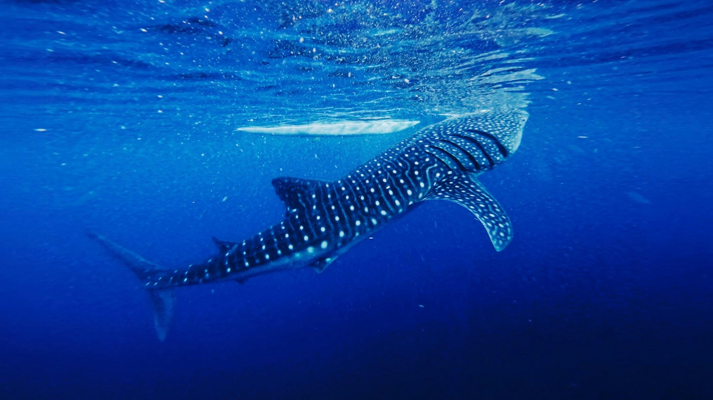

```{=html}
<style>
@import url('https://fonts.googleapis.com/css2?family=Inter:wght@400;500;600;700;800&display=swap');

body {
  font-family: 'Inter', -apple-system, BlinkMacSystemFont, "Segoe UI", Roboto, sans-serif;
  background-color: #f3f7fa;
  color: #1e293b;
}

/* Hide default empty Quarto title block */
#title-block-header {
  display: none !important;
}

/* Full-width layout container */
#quarto-content.page-columns,
main.content.page-columns {
  display: block !important;
  width: 100% !important;
  max-width: 1440px !important;
  padding: 0 2rem 3rem 2rem !important;
  margin: 0 auto !important;
}

/* Ocean-themed Hero Banner */
.hero-banner {
  background: #07192f;
  color: #ffffff;
  padding: 2.85rem 2.5rem;
  border-radius: 16px;
  margin: 1.5rem 0 1.75rem 0;
  box-shadow: 0 12px 30px rgba(7, 25, 47, 0.22);
  position: relative;
  overflow: hidden;
}

.hero-bg-img {
  position: absolute;
  inset: 0;
  width: 100%;
  height: 100%;
  object-fit: cover;
  object-position: 75% 42%;
  opacity: 0.68;
  pointer-events: none;
  z-index: 0;
}

.hero-banner::after {
  content: "";
  position: absolute;
  inset: 0;
  background: linear-gradient(100deg, rgba(7, 25, 47, 0.94) 0%, rgba(13, 59, 102, 0.80) 48%, rgba(13, 59, 102, 0.18) 100%);
  pointer-events: none;
  z-index: 1;
}

.hero-content {
  position: relative;
  z-index: 2;
  max-width: 780px;
}

.hero-eyebrow {
  display: inline-block;
  text-transform: uppercase;
  letter-spacing: 0.1em;
  font-size: 0.78rem;
  font-weight: 700;
  color: #7dd3fc;
  background: rgba(125, 211, 252, 0.12);
  border: 1px solid rgba(125, 211, 252, 0.3);
  padding: 0.3rem 0.75rem;
  border-radius: 999px;
  margin-bottom: 0.85rem;
}

.hero-title {
  font-size: 2.35rem;
  font-weight: 800;
  line-height: 1.2;
  margin: 0 0 0.65rem 0;
  letter-spacing: -0.02em;
  color: #ffffff;
}

.hero-subtitle {
  font-size: 1.05rem;
  line-height: 1.6;
  color: #cbd5e1;
  max-width: 880px;
  margin: 0;
}

/* Filter Row Card */
.filter-row {
  display: grid;
  grid-template-columns: repeat(3, 1fr);
  gap: 1.75rem;
  width: 100%;
  margin-bottom: 2rem;
  background: #ffffff;
  padding: 1.35rem 1.6rem;
  border-radius: 14px;
  border: 1px solid #e2e8f0;
  box-shadow: 0 4px 15px rgba(15, 23, 42, 0.05);
  position: relative;
  z-index: 10;
}

.filter-row .control-label {
  display: block !important;
  font-weight: 600;
  font-size: 0.9rem;
  color: #0f172a;
  margin-bottom: 0.65rem !important;
}

.filter-row .cell-output-display.no-overflow-x {
  overflow: visible !important;
}

/* Plot Card */
.plot-card {
  background: #ffffff;
  border-radius: 16px;
  border: 1px solid #e2e8f0;
  box-shadow: 0 6px 24px rgba(15, 23, 42, 0.06);
  padding: 1.5rem 1.5rem 1.25rem 1.5rem;
}

.plot-card-header {
  display: flex;
  justify-content: space-between;
  align-items: center;
  border-bottom: 1px solid #e2e8f0;
  padding-bottom: 1rem;
  margin-bottom: 1.75rem;
}

.plot-card-title {
  font-size: 1.25rem;
  font-weight: 700;
  color: #0f172a;
  margin: 0;
}

/* Keep Plotly modebar neatly positioned in the top-right corner */
.js-plotly-plot .plotly .modebar {
  top: -42px !important;
  right: 0px !important;
}

/* Styled Tabset for Switching Between Graphs */
.panel-tabset .nav-tabs {
  border-bottom: 2px solid #cbd5e1;
  margin-bottom: 1.5rem;
  gap: 0.5rem;
}

.panel-tabset .nav-tabs .nav-link {
  font-weight: 700;
  font-size: 1rem;
  color: #475569;
  background: #e2e8f0;
  border: 1px solid transparent;
  border-radius: 10px 10px 0 0;
  padding: 0.75rem 1.4rem;
  transition: all 0.15s ease-in-out;
}

.panel-tabset .nav-tabs .nav-link:hover {
  color: #0f172a;
  background: #cbd5e1;
}

.panel-tabset .nav-tabs .nav-link.active {
  color: #ffffff;
  background: linear-gradient(135deg, #0d3b66 0%, #0f766e 100%);
  border-color: #0d3b66;
}

.cell, .cell-output-display, .plotly.html-widget {
  width: 100% !important;
  max-width: 100% !important;
}
</style>
<script>
document.addEventListener("DOMContentLoaded", function() {
  document.querySelectorAll('a[data-bs-toggle="tab"], button[data-bs-toggle="tab"], .panel-tabset .nav-link').forEach(function(tabEl) {
    tabEl.addEventListener('shown.bs.tab', function () {
      window.dispatchEvent(new Event('resize'));
    });
    tabEl.addEventListener('click', function () {
      setTimeout(function() { window.dispatchEvent(new Event('resize')); }, 60);
    });
  });
});
</script>
```

```{r}
library(tidyverse)
library(plotly)
library(crosstalk)

whale_shark_raw <- read_tsv("data/whale_shark/occurrence.txt", show_col_types = FALSE)

# Prepare all 2,391 Whale Shark tracking & sighting points (Coral Sea)
all_occurrences <- whale_shark_raw |>
  mutate(
    id = as.character(id),
    date = as.Date(eventDate),
    shark_name = str_remove(
      coalesce(occurrenceRemarks, "Coral Sea Sighting"),
      "^Animal name:\\s*"
    ),
    track_id = coalesce(as.character(organismID), "Unmarked"),
    is_tagged = !is.na(organismID),
    common_name = paste0("Whale Shark (", shark_name, ")")
  ) |>
  filter(!is.na(date), !is.na(scientificName)) |>
  arrange(track_id, eventDate, id) |>
  mutate(
    first_seen = min(date),
    last_seen = max(date),
    total_span_days = as.numeric(last_seen - first_seen),
    days_elapsed = as.numeric(date - first_seen),
    total_span_months = round(total_span_days / 30.44, 1),
    months_elapsed = round(days_elapsed / 30.44, 2),
    spotting_num = row_number(),
    total_spottings = n(),
    .by = c(scientificName, track_id, shark_name)
  ) |>
  mutate(
    group = if_else(
      is_tagged,
      "Satellite-Tagged Whale Sharks (18 Individuals)",
      "Opportunistic Sightings (Coral Sea)"
    ),
    label = paste0(common_name, " — ID: ", track_id, " (", scientificName, ")"),
    obs_month = month(date, label = TRUE, abbr = TRUE),
    hover_text = paste0(
      "<b>", common_name, "</b><br>",
      "Scientific Name: <i>", scientificName, "</i><br>",
      "Tracking Record: ", label, "<br>",
      "Observation Type: ", group, "<br>",
      "Event Date: ", date, " (", obs_month, ")<br>",
      "Spotting / Tracking #: ", spotting_num, " of ", total_spottings, "<br>",
      "Months Elapsed: ", round(months_elapsed, 1), " months (Total Span: ", total_span_months, " months)<br>",
      "Coordinates: (", round(decimalLatitude, 3), ", ", round(decimalLongitude, 3), ")"
    )
  )

shared_occurrences <- SharedData$new(all_occurrences)
```

```{=html}
<div class="hero-banner">
  
  <div class="hero-content">
    <div class="hero-eyebrow">Coral Sea Satellite Telemetry & Sightings</div>
    <h1 class="hero-title">Coral Sea Whale Sharks: Spottings & Observation Spans</h1>
    <p class="hero-subtitle">
      Explore <strong>2,391 tracking and sighting records</strong> of <strong>Whale Sharks (<em>Rhincodon typus</em>)</strong> across Australia's Coral Sea — comparing 18 satellite-tagged individuals against a decade of opportunistic sightings. Select a graph tab below to explore the interactive scatter plot or the summary bar graphs.
    </p>
  </div>
</div>
```

::: {.panel-tabset}

## 1. Main Scatter Plot (Individual Spottings & Month Spans)

<div class="filter-row">
<div>
```{r}
filter_slider(
  "span_filter",
  "1. Pinpoint Observation Span (Months Elapsed):",
  shared_occurrences,
  ~months_elapsed,
  step = 1
)
```
</div>
<div>
```{r}
filter_slider(
  "spotting_filter",
  "2. Pinpoint Spotting / Tracking Count:",
  shared_occurrences,
  ~spotting_num,
  step = 5
)
```
</div>
<div>
```{r}
filter_select(
  "name_filter",
  "3. Filter by Common Name / Individual:",
  shared_occurrences,
  ~common_name
)
```
</div>
</div>

<div class="plot-card">
<div class="plot-card-header">
  <h2 class="plot-card-title">Cumulative Spottings & Trackings Over Observation Span (Months Elapsed)</h2>
</div>
```{r}
plot_ly(
  data = shared_occurrences,
  x = ~months_elapsed,
  y = ~spotting_num,
  color = ~group,
  colors = c(
    "Satellite-Tagged Whale Sharks (18 Individuals)" = "#0f766e",
    "Opportunistic Sightings (Coral Sea)" = "#0284c7"
  ),
  text = ~hover_text,
  hoverinfo = "text",
  type = "scattergl",
  mode = "markers",
  width = "100%",
  height = 680,
  marker = list(size = 6.5, opacity = 0.75)
) |>
  layout(
    autosize = TRUE,
    paper_bgcolor = "#ffffff",
    plot_bgcolor = "#f8fafc",
    margin = list(t = 95, r = 25, b = 65, l = 70),
    xaxis = list(
      title = "<b>Observation Span Elapsed (Months Since First Sighting)</b>",
      gridcolor = "#e2e8f0",
      zerolinecolor = "#cbd5e1",
      rangemode = "nonnegative",
      minallowed = 0,
      range = c(0, 135),
      tick0 = 0,
      rangeslider = list(visible = TRUE, thickness = 0.08, bgcolor = "#f1f5f9", range = c(0, 135))
    ),
    yaxis = list(
      title = "<b>Cumulative Spotting / Tracking Count</b>",
      gridcolor = "#e2e8f0",
      zerolinecolor = "#cbd5e1",
      rangemode = "nonnegative",
      minallowed = 0,
      range = c(0, 450),
      tick0 = 0
    ),
    legend = list(orientation = "h", x = 1, xanchor = "right", y = 1.12, yanchor = "bottom"),
    updatemenus = list(
      list(
        type = "dropdown",
        x = 0,
        xanchor = "left",
        y = 1.02,
        yanchor = "bottom",
        bgcolor = "#f8fafc",
        bordercolor = "#cbd5e1",
        buttons = list(
          list(
            label = "View: All Timeframes (0–132 Months)",
            method = "relayout",
            args = list(list(
              "xaxis.type" = "linear",
              "xaxis.range" = c(0, 135),
              "yaxis.range" = c(0, 450)
            ))
          ),
          list(
            label = "View: Spread Evenly (Log Scale X-Axis)",
            method = "relayout",
            args = list(list(
              "xaxis.type" = "log",
              "xaxis.autorange" = TRUE,
              "yaxis.range" = c(0, 450)
            ))
          ),
          list(
            label = "Zoom: Tagged Whale Sharks (0–14 Months)",
            method = "relayout",
            args = list(list(
              "xaxis.type" = "linear",
              "xaxis.range" = c(0, 14),
              "yaxis.range" = c(0, 450)
            ))
          ),
          list(
            label = "Zoom: Multi-Year Tagged Sharks (0–27 Months)",
            method = "relayout",
            args = list(list(
              "xaxis.type" = "linear",
              "xaxis.range" = c(0, 27),
              "yaxis.range" = c(0, 450)
            ))
          ),
          list(
            label = "Zoom: Long-Term Opportunistic Sightings (10–132 Months)",
            method = "relayout",
            args = list(list(
              "xaxis.type" = "linear",
              "xaxis.range" = c(10, 135),
              "yaxis.range" = c(0, 160)
            ))
          )
        )
      )
    )
  ) |>
  config(responsive = TRUE)
```
</div>

## 2. Bar Graph (Monthly Comparison & Total Spottings)

<div class="plot-card" style="margin-bottom: 1.75rem;">
<div class="plot-card-header">
  <h2 class="plot-card-title">Seasonal Activity by Calendar Month (Jan–Dec)</h2>
</div>
```{r}
monthly_summary <- all_occurrences |>
  summarize(
    monthly_spottings = n(),
    .by = c(obs_month, group)
  ) |>
  complete(
    obs_month = factor(month.abb, levels = month.abb, ordered = TRUE),
    group,
    fill = list(monthly_spottings = 0)
  ) |>
  mutate(
    month_hover = paste0(
      "<b>Month: ", obs_month, "</b><br>",
      "Group: ", group, "<br>",
      "Total Spottings / Detections: <b>", scales::comma(monthly_spottings), "</b>"
    )
  )

plot_ly(
  data = monthly_summary,
  x = ~obs_month,
  y = ~monthly_spottings,
  color = ~group,
  colors = c(
    "Satellite-Tagged Whale Sharks (18 Individuals)" = "#0f766e",
    "Opportunistic Sightings (Coral Sea)" = "#0284c7"
  ),
  text = ~month_hover,
  hoverinfo = "text",
  type = "bar",
  width = "100%",
  height = 520
) |>
  layout(
    barmode = "group",
    autosize = TRUE,
    paper_bgcolor = "#ffffff",
    plot_bgcolor = "#f8fafc",
    margin = list(t = 50, r = 25, b = 70, l = 70),
    xaxis = list(
      title = "<b>Calendar Month of the Year</b>",
      gridcolor = "#e2e8f0"
    ),
    yaxis = list(
      title = "<b>Total Recorded Spottings / Transmissions</b>",
      gridcolor = "#e2e8f0",
      zerolinecolor = "#cbd5e1",
      rangemode = "nonnegative",
      minallowed = 0
    ),
    legend = list(orientation = "h", x = 1, xanchor = "right", y = 1.04, yanchor = "bottom")
  ) |>
  config(responsive = TRUE)
```
</div>

<div class="plot-card">
<div class="plot-card-header">
  <h2 class="plot-card-title">Total Detections by Individual Whale Shark (With Span in Months)</h2>
</div>
```{r}
organism_summary <- all_occurrences |>
  summarize(
    total_spottings = n(),
    total_span_months = max(total_span_months),
    first_seen = min(first_seen),
    last_seen = max(last_seen),
    .by = c(common_name, group)
  ) |>
  arrange(desc(total_spottings)) |>
  mutate(
    common_name = fct_inorder(common_name),
    bar_hover = paste0(
      "<b>", common_name, "</b><br>",
      "Observation Type: ", group, "<br>",
      "Total Spottings / Transmissions: <b>", scales::comma(total_spottings), "</b><br>",
      "Observation Span: <b>", total_span_months, " months</b> (",
      first_seen, " to ", last_seen, ")"
    )
  )

plot_ly(
  data = organism_summary,
  x = ~common_name,
  y = ~total_spottings,
  color = ~group,
  colors = c(
    "Satellite-Tagged Whale Sharks (18 Individuals)" = "#0f766e",
    "Opportunistic Sightings (Coral Sea)" = "#0284c7"
  ),
  text = ~bar_hover,
  hoverinfo = "text",
  type = "bar",
  width = "100%",
  height = 620
) |>
  layout(
    autosize = TRUE,
    paper_bgcolor = "#ffffff",
    plot_bgcolor = "#f8fafc",
    margin = list(t = 50, r = 25, b = 140, l = 70),
    xaxis = list(
      title = "",
      tickangle = -35,
      gridcolor = "#e2e8f0"
    ),
    yaxis = list(
      title = "<b>Total Recorded Spottings / Transmissions</b>",
      gridcolor = "#e2e8f0",
      zerolinecolor = "#cbd5e1",
      rangemode = "nonnegative",
      minallowed = 0,
      range = c(0, 460)
    ),
    legend = list(orientation = "h", x = 1, xanchor = "right", y = 1.04, yanchor = "bottom")
  ) |>
  config(responsive = TRUE)
```
</div>

:::
