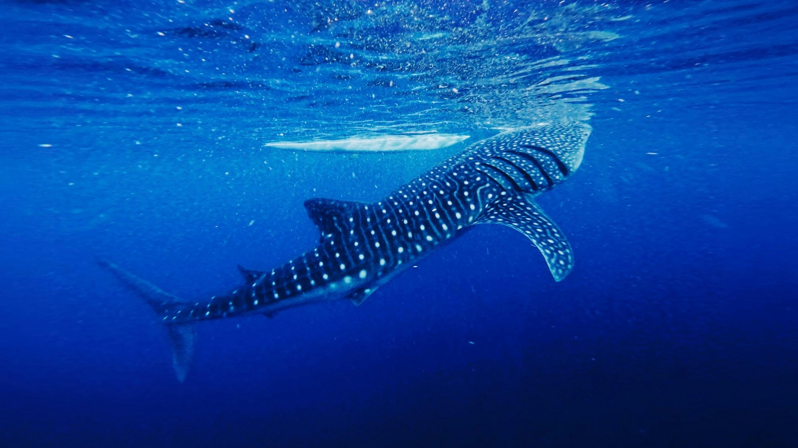
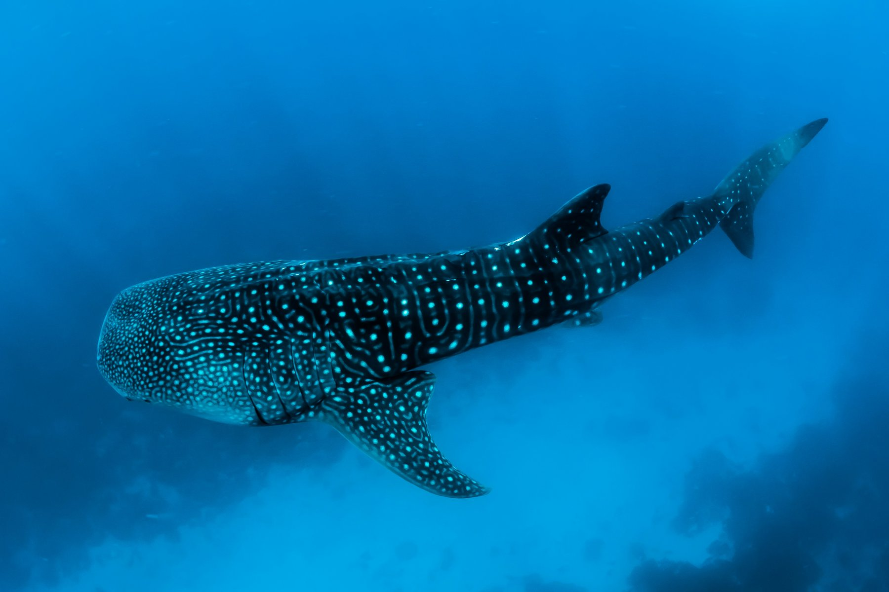
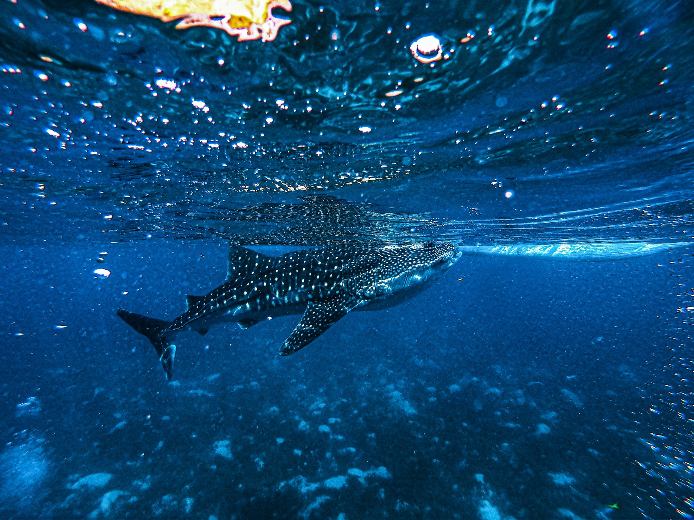
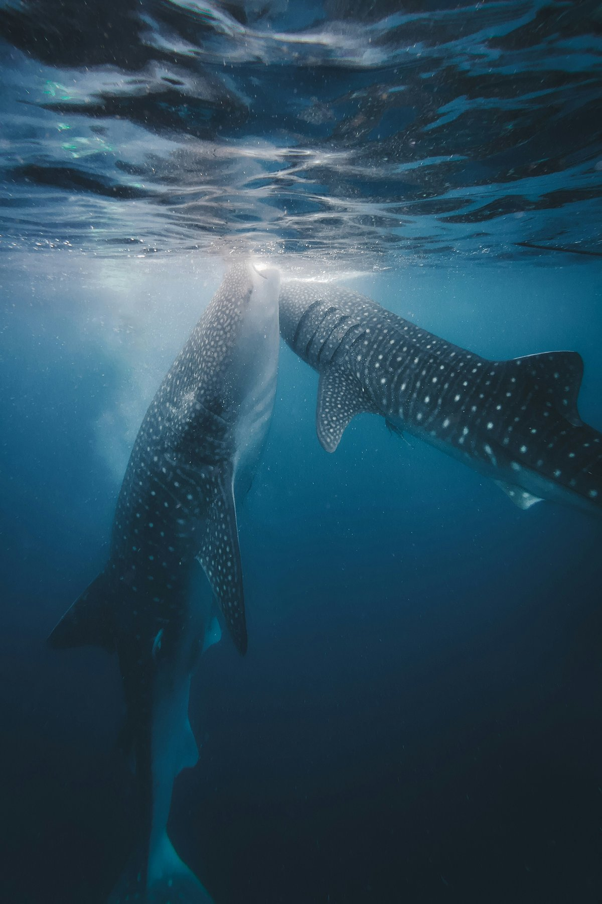

```{=html}
<style>
@import url('https://fonts.googleapis.com/css2?family=Inter:wght@400;500;600;700;800&display=swap');

body {
  font-family: 'Inter', -apple-system, BlinkMacSystemFont, "Segoe UI", Roboto, sans-serif;
  background-color: #f3f7fa;
  color: #1e293b;
}

#title-block-header {
  display: none !important;
}

#quarto-content.page-columns,
main.content.page-columns {
  display: block !important;
  width: 100% !important;
  max-width: 1200px !important;
  padding: 0 2rem 3.5rem 2rem !important;
  margin: 0 auto !important;
}

.hero-banner {
  background: #07192f;
  color: #ffffff;
  padding: 2.75rem 2.5rem;
  border-radius: 16px;
  margin: 1.5rem 0 2.25rem 0;
  box-shadow: 0 12px 30px rgba(7, 25, 47, 0.22);
  position: relative;
  overflow: hidden;
}

.hero-bg-img {
  position: absolute;
  inset: 0;
  width: 100%;
  height: 100%;
  object-fit: cover;
  object-position: 75% 42%;
  opacity: 0.66;
  pointer-events: none;
  z-index: 0;
}

.hero-banner::after {
  content: "";
  position: absolute;
  inset: 0;
  background: linear-gradient(100deg, rgba(7, 25, 47, 0.94) 0%, rgba(13, 59, 102, 0.80) 48%, rgba(20, 99, 143, 0.20) 100%);
  pointer-events: none;
  z-index: 1;
}

.hero-content {
  position: relative;
  z-index: 2;
  max-width: 680px;
}

.hero-eyebrow {
  display: inline-block;
  text-transform: uppercase;
  letter-spacing: 0.1em;
  font-size: 0.78rem;
  font-weight: 700;
  color: #7dd3fc;
  background: rgba(125, 211, 252, 0.12);
  border: 1px solid rgba(125, 211, 252, 0.3);
  padding: 0.3rem 0.75rem;
  border-radius: 999px;
  margin-bottom: 0.85rem;
}

.hero-title {
  font-size: 2.2rem;
  font-weight: 800;
  line-height: 1.2;
  margin: 0 0 0.5rem 0;
  color: #ffffff;
}

.hero-subtitle {
  font-size: 1.05rem;
  line-height: 1.6;
  color: #cbd5e1;
  margin: 0;
}

/* Top compact horizontal flow bar */
.flow-overview {
  display: flex;
  align-items: center;
  justify-content: space-between;
  background: #ffffff;
  border: 1px solid #e2e8f0;
  border-radius: 14px;
  padding: 1.15rem 1.5rem;
  margin-bottom: 2rem;
  box-shadow: 0 4px 14px rgba(15, 23, 42, 0.04);
  overflow-x: auto;
  gap: 0.4rem;
}

.flow-pill {
  display: flex;
  align-items: center;
  gap: 0.5rem;
  font-weight: 700;
  font-size: 0.86rem;
  color: #0d3b66;
  white-space: nowrap;
}

.flow-pill-num {
  width: 24px;
  height: 24px;
  border-radius: 50%;
  background: linear-gradient(135deg, #0d3b66, #0f766e);
  color: #ffffff;
  font-size: 0.75rem;
  font-weight: 800;
  display: inline-flex;
  align-items: center;
  justify-content: center;
}

.flow-arrow {
  color: #94a3b8;
  font-weight: 700;
  font-size: 1.1rem;
  padding: 0 0.25rem;
}

/* Connected timeline sequence */
.process-timeline {
  position: relative;
  max-width: 880px;
  margin: 0 auto;
  padding-left: 3.5rem;
}

.process-timeline::before {
  content: "";
  position: absolute;
  top: 28px;
  bottom: 28px;
  left: 22px;
  width: 4px;
  border-radius: 4px;
  background: linear-gradient(180deg, #0d3b66 0%, #14638f 50%, #0f766e 100%);
}

.process-step {
  position: relative;
  background: #ffffff;
  border: 1px solid #e2e8f0;
  border-radius: 16px;
  padding: 1.5rem 1.85rem;
  margin-bottom: 1.35rem;
  box-shadow: 0 5px 18px rgba(15, 23, 42, 0.05);
  display: flex;
  align-items: flex-start;
  gap: 1.25rem;
  transition: transform 0.15s ease, box-shadow 0.15s ease;
}

.process-step:hover {
  transform: translateY(-2px);
  box-shadow: 0 10px 24px rgba(15, 23, 42, 0.09);
}

.step-node {
  position: absolute;
  left: -3.5rem;
  top: 1.45rem;
  width: 48px;
  height: 48px;
  border-radius: 50%;
  background: linear-gradient(135deg, #07192f 0%, #0d3b66 60%, #0f766e 100%);
  color: #ffffff;
  font-weight: 800;
  font-size: 1.05rem;
  display: flex;
  align-items: center;
  justify-content: center;
  border: 4px solid #f3f7fa;
  box-shadow: 0 4px 12px rgba(13, 59, 102, 0.25);
}

.step-icon {
  width: 48px;
  height: 48px;
  min-width: 48px;
  border-radius: 12px;
  background: #eff6ff;
  border: 1px solid #dbeafe;
  display: flex;
  align-items: center;
  justify-content: center;
  font-size: 1.45rem;
}

.step-body {
  flex: 1;
}

.step-label {
  font-size: 0.75rem;
  font-weight: 700;
  text-transform: uppercase;
  letter-spacing: 0.08em;
  color: #0f766e;
  margin-bottom: 0.2rem;
}

.step-title {
  font-size: 1.28rem;
  font-weight: 800;
  color: #0f172a;
  margin: 0 0 0.35rem 0;
}

.step-desc {
  font-size: 1rem;
  line-height: 1.6;
  color: #475569;
  margin: 0;
}

.process-step.has-media {
  padding: 0;
  align-items: stretch;
  gap: 0;
}

.step-main {
  display: flex;
  align-items: flex-start;
  gap: 1.25rem;
  padding: 1.5rem 1.75rem;
  flex: 1;
}

.step-media {
  width: 225px;
  min-width: 225px;
  border-radius: 0 15px 15px 0;
  overflow: hidden;
  position: relative;
  background: #07192f;
}

.step-media img {
  width: 100%;
  height: 100%;
  min-height: 132px;
  object-fit: cover;
  display: block;
}

.step-media::after {
  content: "";
  position: absolute;
  inset: 0;
  background: linear-gradient(90deg, rgba(255, 255, 255, 0.18) 0%, rgba(7, 25, 47, 0.08) 100%);
  pointer-events: none;
}

@media (max-width: 720px) {
  .process-step.has-media {
    flex-direction: column;
  }
  .step-media {
    width: 100%;
    height: 170px;
    border-radius: 0 0 15px 15px;
  }
}

.step-connector {
  text-align: center;
  color: #0d3b66;
  font-size: 1.15rem;
  font-weight: 800;
  margin: -0.55rem 0 0.75rem 0;
  opacity: 0.55;
}

/* Limitations of the Research Styles */
.limitations-section {
  margin-top: 2.75rem;
  margin-bottom: 2rem;
}

.limitations-header {
  border-bottom: 1px solid rgba(148, 163, 184, 0.2);
  padding-bottom: 1rem;
  margin-bottom: 1.5rem;
}

.limitations-eyebrow {
  display: inline-block;
  text-transform: uppercase;
  letter-spacing: 0.1em;
  font-size: 0.78rem;
  font-weight: 600;
  color: var(--ocean-coral, #ff8573);
  background: rgba(255, 133, 115, 0.14);
  border: 1px solid rgba(255, 133, 115, 0.42);
  padding: 0.3rem 0.8rem;
  border-radius: 999px;
  margin-bottom: 0.75rem;
}

.limitations-title {
  font-size: 1.75rem;
  font-weight: 700;
  color: #ffffff;
  margin: 0 0 0.5rem 0;
}

.limitations-intro {
  font-size: 0.98rem;
  line-height: 1.6;
  color: #dbeafe;
  margin: 0;
  max-width: 920px;
}

.limitations-grid {
  display: grid;
  grid-template-columns: repeat(auto-fit, minmax(320px, 1fr));
  gap: 1.25rem;
  margin-bottom: 1.75rem;
}

.limitation-item {
  background: rgba(7, 20, 38, 0.65);
  border: 1px solid rgba(125, 211, 252, 0.2);
  border-radius: 14px;
  padding: 1.25rem 1.35rem;
  display: flex;
  gap: 1rem;
  align-items: flex-start;
  backdrop-filter: blur(10px);
  transition: transform 0.2s ease, border-color 0.2s ease, box-shadow 0.2s ease;
}

.limitation-item:hover {
  transform: translateY(-2px);
  border-color: rgba(34, 211, 238, 0.45);
  box-shadow: 0 8px 24px rgba(4, 12, 26, 0.35);
}

.limitation-icon {
  width: 44px;
  height: 44px;
  min-width: 44px;
  border-radius: 12px;
  background: rgba(34, 211, 238, 0.12);
  border: 1px solid rgba(34, 211, 238, 0.28);
  display: flex;
  align-items: center;
  justify-content: center;
  font-size: 1.4rem;
}

.limitation-item:nth-child(2) .limitation-icon {
  background: rgba(255, 133, 115, 0.12);
  border-color: rgba(255, 133, 115, 0.3);
}

.limitation-item:nth-child(3) .limitation-icon {
  background: rgba(45, 212, 191, 0.12);
  border-color: rgba(45, 212, 191, 0.3);
}

.limitation-item:nth-child(4) .limitation-icon {
  background: rgba(168, 85, 247, 0.12);
  border-color: rgba(168, 85, 247, 0.3);
}

.limitation-item:nth-child(5) .limitation-icon {
  background: rgba(245, 158, 11, 0.12);
  border-color: rgba(245, 158, 11, 0.3);
}

.limitation-item:nth-child(6) .limitation-icon {
  background: rgba(56, 189, 248, 0.12);
  border-color: rgba(56, 189, 248, 0.3);
}

.limitation-body {
  flex: 1;
}

.limitation-name {
  font-size: 1.08rem;
  font-weight: 700;
  color: #ffffff;
  margin: 0 0 0.35rem 0;
}

.limitation-text {
  font-size: 0.9rem;
  line-height: 1.55;
  color: #dbeafe;
  margin: 0;
}

.limitations-conclusion {
  background: rgba(13, 37, 65, 0.7);
  border: 1px solid rgba(255, 133, 115, 0.35);
  border-left: 4px solid var(--ocean-coral, #ff8573);
  border-radius: 12px;
  padding: 1.25rem 1.45rem;
  backdrop-filter: blur(8px);
}

.limitations-conclusion h4 {
  font-size: 1rem;
  font-weight: 700;
  color: #ffffff;
  margin: 0 0 0.4rem 0;
  display: flex;
  align-items: center;
  gap: 0.45rem;
}

.limitations-conclusion p {
  font-size: 0.92rem;
  line-height: 1.6;
  color: #f1f5f9;
  margin: 0;
}
</style>

<div class="hero-banner">
  
  <div class="hero-content">
    <div class="hero-eyebrow">Methodology Pipeline</div>
    <h1 class="hero-title">From Ocean Sighting to Conservation Action</h1>
    <p class="hero-subtitle">
      How whale shark encounters turn into satellite tracking datasets and marine protection decisions.
    </p>
  </div>
</div>

<div class="flow-overview" aria-label="Six-step research sequence overview">
  <div class="flow-pill"><span class="flow-pill-num">1</span> Observation</div>
  <span class="flow-arrow">&rarr;</span>
  <div class="flow-pill"><span class="flow-pill-num">2</span> Identification</div>
  <span class="flow-arrow">&rarr;</span>
  <div class="flow-pill"><span class="flow-pill-num">3</span> Satellite Tagging</div>
  <span class="flow-arrow">&rarr;</span>
  <div class="flow-pill"><span class="flow-pill-num">4</span> Data Collection</div>
  <span class="flow-arrow">&rarr;</span>
  <div class="flow-pill"><span class="flow-pill-num">5</span> Analysis</div>
  <span class="flow-arrow">&rarr;</span>
  <div class="flow-pill"><span class="flow-pill-num">6</span> Conservation</div>
</div>

<div class="process-timeline">

  <div class="process-step">
    <div class="step-node">1</div>
    <div class="step-icon">&#128301;</div>
    <div class="step-body">
      <div class="step-label">Step 1</div>
      <h2 class="step-title">Observation</h2>
      <p class="step-desc">Researchers, citizen scientists and public databases contribute whale shark sightings.</p>
    </div>
  </div>
  <div class="step-connector">&darr;</div>

  <div class="process-step has-media">
    <div class="step-node">2</div>
    <div class="step-main">
      <div class="step-icon">&#128247;</div>
      <div class="step-body">
        <div class="step-label">Step 2</div>
        <h2 class="step-title">Identification</h2>
        <p class="step-desc">Researchers identify individual sharks and collect information about their characteristics.</p>
      </div>
    </div>
    <div class="step-media">
      
    </div>
  </div>
  <div class="step-connector">&darr;</div>

  <div class="process-step">
    <div class="step-node">3</div>
    <div class="step-icon">&#128752;</div>
    <div class="step-body">
      <div class="step-label">Step 3</div>
      <h2 class="step-title">Satellite Tagging</h2>
      <p class="step-desc">Selected sharks are fitted with satellite tracking devices.</p>
    </div>
  </div>
  <div class="step-connector">&darr;</div>

  <div class="process-step has-media">
    <div class="step-node">4</div>
    <div class="step-main">
      <div class="step-icon">&#128225;</div>
      <div class="step-body">
        <div class="step-label">Step 4</div>
        <h2 class="step-title">Data Collection</h2>
        <p class="step-desc">Location information is collected and compiled into research datasets.</p>
      </div>
    </div>
    <div class="step-media">
      
    </div>
  </div>
  <div class="step-connector">&darr;</div>

  <div class="process-step">
    <div class="step-node">5</div>
    <div class="step-icon">&#128202;</div>
    <div class="step-body">
      <div class="step-label">Step 5</div>
      <h2 class="step-title">Analysis</h2>
      <p class="step-desc">Scientists examine movement, distribution, aggregation sites and seasonal patterns.</p>
    </div>
  </div>
  <div class="step-connector">&darr;</div>

  <div class="process-step has-media">
    <div class="step-node">6</div>
    <div class="step-main">
      <div class="step-icon">&#127754;</div>
      <div class="step-body">
        <div class="step-label">Step 6</div>
        <h2 class="step-title">Conservation</h2>
        <p class="step-desc">Research findings help identify important habitats and inform conservation decisions.</p>
      </div>
    </div>
    <div class="step-media">
      
    </div>
  </div>

</div>

<!-- Limitations of the Research Section -->
<div class="info-card limitations-section">
  <div class="limitations-header">
    <div class="limitations-eyebrow">Scientific Rigor &amp; Context</div>
    <h2 class="limitations-title">Limitations of the Research</h2>
    <p class="limitations-intro">
      Understanding what telemetry data reveals and where uncertainties remain is essential for sound conservation science.
    </p>
  </div>

  <div class="limitations-grid">
    <!-- Limitation 1: Sample Size -->
    <div class="limitation-item">
      <div class="limitation-icon">🦈</div>
      <div class="limitation-body">
        <h3 class="limitation-name">Sample Size</h3>
        <p class="limitation-text">
          Eighteen tagged individuals may not reflect the movement patterns, age classes, or sex ratios of the entire Coral Sea population.
        </p>
      </div>
    </div>

    <!-- Limitation 2: Tracking Gaps -->
    <div class="limitation-item">
      <div class="limitation-icon">📡</div>
      <div class="limitation-body">
        <h3 class="limitation-name">Tracking Gaps</h3>
        <p class="limitation-text">
          Tags transmit only at the surface; transmission gaps reflect deep diving or foraging, not shark absence.
        </p>
      </div>
    </div>

    <!-- Limitation 3: Historical Sightings Bias -->
    <div class="limitation-item">
      <div class="limitation-icon">📍</div>
      <div class="limitation-body">
        <h3 class="limitation-name">Sighting Bias</h3>
        <p class="limitation-text">
          Historical sightings cluster where people regularly visit (dive and tourism hubs), reflecting human observation effort.
        </p>
      </div>
    </div>

    <!-- Limitation 4: Behavioral Information -->
    <div class="limitation-item">
      <div class="limitation-icon">🏊</div>
      <div class="limitation-body">
        <h3 class="limitation-name">Behavioral Context</h3>
        <p class="limitation-text">
          Satellite coordinates record location and surface basking, but do not directly confirm feeding, resting, or mating.
        </p>
      </div>
    </div>

    <!-- Limitation 5: Geographic Scope -->
    <div class="limitation-item">
      <div class="limitation-icon">🌏</div>
      <div class="limitation-body">
        <h3 class="limitation-name">Geographic Scope</h3>
        <p class="limitation-text">
          Findings reflect Coral Sea and southwest Pacific oceanography, rather than all global whale shark populations.
        </p>
      </div>
    </div>

    <!-- Limitation 6: Tag Differences -->
    <div class="limitation-item">
      <div class="limitation-icon">🏷️</div>
      <div class="limitation-body">
        <h3 class="limitation-name">Tag Retention</h3>
        <p class="limitation-text">
          Attachment retention, battery lifespan, and satellite pass timing create differences in tracking duration across sharks.
        </p>
      </div>
    </div>
  </div>

  <div class="limitations-conclusion">
    <h4><span>💡</span> Why Limitations Matter</h4>
    <p>
      Recognizing data limits prevents overgeneralization and ensures marine protection measures are founded on solid evidence.
    </p>
  </div>
</div>
```
