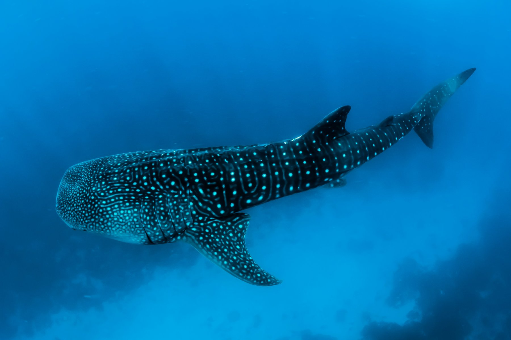
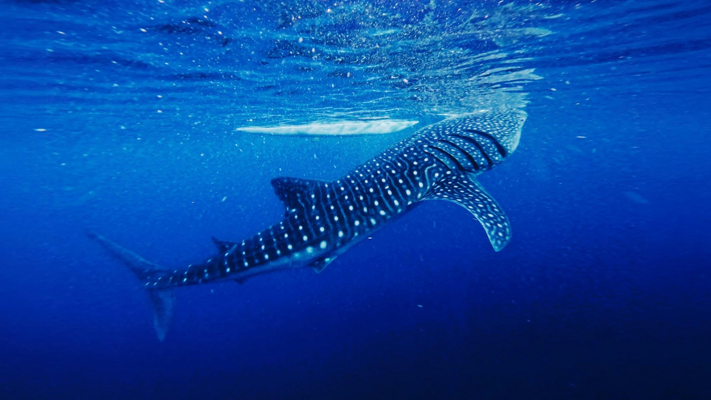
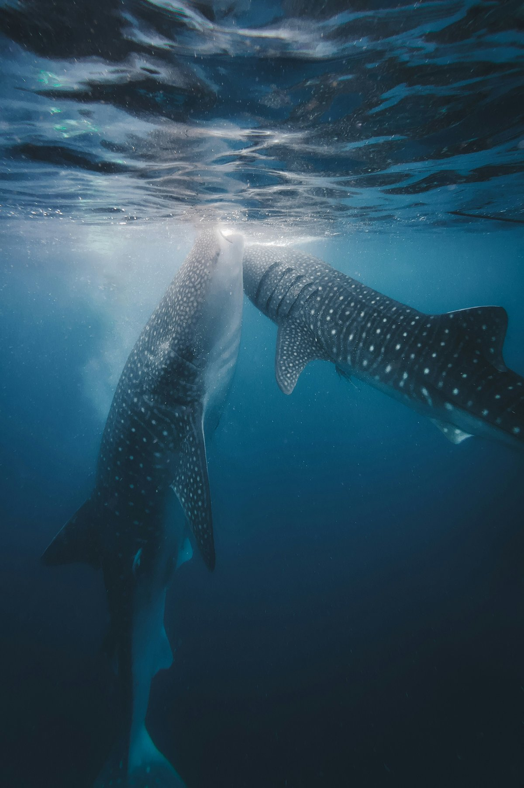
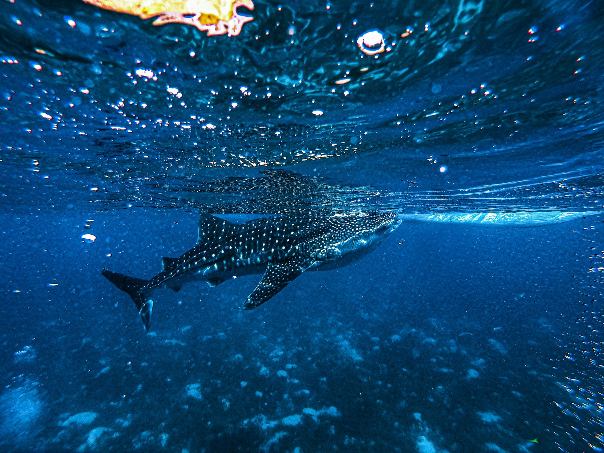

```{=html}
<style>
@import url('https://fonts.googleapis.com/css2?family=Inter:wght@400;500;600;700;800&display=swap');

body {
  font-family: 'Plus Jakarta Sans', -apple-system, BlinkMacSystemFont, "Segoe UI", Roboto, sans-serif;
  color: var(--ocean-text, #f1f5f9);
}

#title-block-header {
  display: none !important;
}

#quarto-content.page-columns,
main.content.page-columns {
  display: block !important;
  width: 100% !important;
  max-width: 1440px !important;
  padding: 0 2rem 3rem 2rem !important;
  margin: 0 auto !important;
}

.hero-banner {
  background: #07192f;
  color: #ffffff;
  padding: 2.75rem 2.5rem;
  border-radius: 16px;
  margin: 1.5rem 0 1.75rem 0;
  box-shadow: 0 12px 30px rgba(7, 25, 47, 0.22);
  position: relative;
  overflow: hidden;
}

.hero-bg-img {
  position: absolute;
  inset: 0;
  width: 100%;
  height: 100%;
  object-fit: cover;
  object-position: 65% 48%;
  opacity: 0.64;
  pointer-events: none;
  z-index: 0;
}

.hero-banner::after {
  content: "";
  position: absolute;
  inset: 0;
  background: linear-gradient(100deg, rgba(7, 25, 47, 0.94) 0%, rgba(13, 59, 102, 0.80) 48%, rgba(15, 118, 110, 0.22) 100%);
  pointer-events: none;
  z-index: 1;
}

.hero-content {
  position: relative;
  z-index: 2;
  max-width: 780px;
}

.hero-eyebrow {
  display: inline-block;
  text-transform: uppercase;
  letter-spacing: 0.1em;
  font-size: 0.78rem;
  font-weight: 700;
  color: #7dd3fc;
  background: rgba(125, 211, 252, 0.12);
  border: 1px solid rgba(125, 211, 252, 0.3);
  padding: 0.3rem 0.75rem;
  border-radius: 999px;
  margin-bottom: 0.85rem;
}

.hero-title {
  font-size: 2.25rem;
  font-weight: 800;
  line-height: 1.2;
  margin: 0 0 0.6rem 0;
  color: #ffffff;
}

.hero-subtitle {
  font-size: 1.05rem;
  line-height: 1.6;
  color: #cbd5e1;
  max-width: 920px;
  margin: 0;
}

.map-card {
  background: linear-gradient(165deg, rgba(255, 255, 255, 0.08) 0%, var(--ocean-panel, rgba(9, 25, 46, 0.52)) 100%);
  border-radius: 16px;
  border: 1px solid var(--ocean-border, rgba(125, 211, 252, 0.24));
  box-shadow: 0 14px 34px rgba(5, 15, 30, 0.3);
  backdrop-filter: blur(16px);
  -webkit-backdrop-filter: blur(16px);
  padding: 1.5rem;
  margin-bottom: 1.5rem;
  color: var(--ocean-text, #f1f5f9);
}

.map-card-header {
  border-bottom: 1px solid rgba(148, 163, 184, 0.2);
  padding-bottom: 0.85rem;
  margin-bottom: 1rem;
}

.map-card-title {
  font-size: 1.25rem;
  font-weight: 700;
  color: #ffffff;
  margin: 0;
}

.map-caption {
  margin-top: 1rem;
  padding-top: 0.9rem;
  border-top: 1px solid rgba(148, 163, 184, 0.2);
  font-size: 0.95rem;
  line-height: 1.55;
  color: #dbeafe;
}

.leaflet-container {
  border-radius: 12px;
  background: #09192e !important;
  border: 1px solid rgba(56, 189, 248, 0.25) !important;
}

/* Styled Tabset for Switching Between Maps */
.panel-tabset .nav-tabs {
  border-bottom: 1px solid var(--ocean-border, rgba(125, 211, 252, 0.24));
  margin-bottom: 1.5rem;
  gap: 0.5rem;
}

.panel-tabset .nav-tabs .nav-link {
  font-weight: 600;
  font-size: 0.95rem;
  color: #dbeafe;
  background: rgba(9, 25, 46, 0.62);
  border: 1px solid rgba(148, 163, 184, 0.28);
  border-radius: 10px 10px 0 0;
  padding: 0.75rem 1.4rem;
  transition: all 0.2s ease-in-out;
}

.panel-tabset .nav-tabs .nav-link:hover {
  color: #ffffff;
  background: rgba(34, 211, 238, 0.15);
  border-color: var(--ocean-cyan, #22d3ee);
}

.panel-tabset .nav-tabs .nav-link.active {
  color: #ffffff;
  background: linear-gradient(135deg, rgba(14, 116, 144, 0.9) 0%, rgba(45, 212, 191, 0.8) 100%);
  border-color: var(--ocean-cyan, #22d3ee);
  box-shadow: 0 0 18px rgba(34, 211, 238, 0.25);
}

/* Interactive Whale Shark Map Controls */
.ws-controls-panel {
  background: var(--ocean-panel-sub, rgba(7, 20, 38, 0.48));
  border: 1px solid rgba(125, 211, 252, 0.2);
  border-radius: 12px;
  padding: 1.15rem 1.25rem;
  margin-bottom: 1.15rem;
}

.ws-top-toggles {
  display: flex;
  flex-wrap: wrap;
  justify-content: space-between;
  align-items: center;
  gap: 1rem;
  padding-bottom: 1rem;
  margin-bottom: 1rem;
  border-bottom: 1px solid rgba(148, 163, 184, 0.2);
}

.ws-toggle-group {
  display: flex;
  flex-wrap: wrap;
  align-items: center;
  gap: 0.45rem;
}

.ws-toggle-label {
  font-size: 0.82rem;
  font-weight: 700;
  text-transform: uppercase;
  letter-spacing: 0.05em;
  color: var(--ocean-muted, #b6c8dc);
  margin-right: 0.35rem;
}

.ws-btn {
  font-family: inherit;
  font-size: 0.85rem;
  font-weight: 600;
  color: #dbeafe;
  background: rgba(9, 25, 46, 0.62);
  border: 1px solid rgba(148, 163, 184, 0.28);
  border-radius: 8px;
  padding: 0.42rem 0.85rem;
  cursor: pointer;
  transition: all 0.2s ease;
}

.ws-btn:hover {
  background: rgba(34, 211, 238, 0.2);
  color: #ffffff;
  border-color: var(--ocean-cyan, #22d3ee);
}

.ws-btn.active {
  background: linear-gradient(135deg, rgba(14, 116, 144, 0.9) 0%, rgba(45, 212, 191, 0.8) 100%);
  color: #ffffff;
  border-color: var(--ocean-cyan, #22d3ee);
  box-shadow: 0 0 16px rgba(34, 211, 238, 0.22);
}

.ws-filter-grid {
  display: grid;
  grid-template-columns: repeat(4, 1fr);
  gap: 0.9rem;
  margin-bottom: 1rem;
}

@media (max-width: 900px) {
  .ws-filter-grid {
    grid-template-columns: repeat(2, 1fr);
  }
}

@media (max-width: 520px) {
  .ws-filter-grid {
    grid-template-columns: 1fr;
  }
}

.ws-field label {
  display: block;
  font-size: 0.82rem;
  font-weight: 700;
  color: #ffffff;
  margin-bottom: 0.35rem;
}

.ws-field select {
  width: 100%;
  font-family: inherit;
  font-size: 0.88rem;
  color: #f8fafc;
  background: rgba(7, 20, 38, 0.85);
  border: 1px solid rgba(56, 189, 248, 0.32);
  border-radius: 8px;
  padding: 0.48rem 0.65rem;
}

.ws-slider-box {
  background: var(--ocean-panel-sub, rgba(7, 20, 38, 0.48));
  border: 1px solid rgba(125, 211, 252, 0.2);
  border-radius: 10px;
  padding: 0.85rem 1rem;
}

.ws-slider-header {
  display: flex;
  justify-content: space-between;
  align-items: center;
  flex-wrap: wrap;
  gap: 0.5rem;
  margin-bottom: 0.55rem;
  font-size: 0.86rem;
  font-weight: 700;
  color: #ffffff;
}

.ws-date-badge {
  font-size: 0.82rem;
  font-weight: 700;
  color: var(--ocean-coral, #ff8573);
  background: rgba(255, 133, 115, 0.16);
  border: 1px solid rgba(255, 133, 115, 0.45);
  padding: 0.25rem 0.75rem;
  border-radius: 999px;
}

.ws-dual-slider {
  display: grid;
  grid-template-columns: 1fr 1fr auto;
  gap: 0.9rem;
  align-items: center;
}

@media (max-width: 768px) {
  .ws-dual-slider {
    grid-template-columns: 1fr;
  }
}

.ws-range-wrap {
  display: flex;
  align-items: center;
  gap: 0.5rem;
  font-size: 0.8rem;
  color: var(--ocean-muted, #b6c8dc);
  font-weight: 600;
}

.ws-range-wrap input[type="range"] {
  flex: 1;
  accent-color: var(--ocean-cyan, #22d3ee);
  cursor: pointer;
}

.ws-status-bar {
  display: flex;
  justify-content: space-between;
  align-items: center;
  flex-wrap: wrap;
  gap: 0.5rem;
  margin-bottom: 0.75rem;
  font-size: 0.88rem;
  color: #dbeafe;
}

/* Dark Ocean Leaflet Popups, Legend & Controls */
.leaflet-popup-content-wrapper {
  background: rgba(9, 25, 46, 0.95) !important;
  color: #f1f5f9 !important;
  border: 1px solid rgba(34, 211, 238, 0.35) !important;
  box-shadow: 0 8px 24px rgba(4, 12, 26, 0.5) !important;
  border-radius: 10px !important;
  backdrop-filter: blur(10px);
}

.leaflet-popup-tip {
  background: rgba(9, 25, 46, 0.95) !important;
}

.leaflet-popup-close-button {
  color: #94a3b8 !important;
}

.leaflet-popup-close-button:hover {
  color: #ffffff !important;
}

.leaflet-control-layers, .info.legend {
  background: rgba(9, 25, 46, 0.92) !important;
  color: #f1f5f9 !important;
  border: 1px solid rgba(56, 189, 248, 0.3) !important;
  border-radius: 8px !important;
  box-shadow: 0 4px 16px rgba(4, 12, 26, 0.45) !important;
}

.info.legend strong, .info.legend span {
  color: #f1f5f9 !important;
}

.leaflet-control-layers label {
  color: #f1f5f9 !important;
}

.leaflet-bar a {
  background: rgba(9, 25, 46, 0.9) !important;
  color: #ffffff !important;
  border-color: rgba(56, 189, 248, 0.28) !important;
}

.leaflet-bar a:hover {
  background: rgba(34, 211, 238, 0.25) !important;
  color: #22d3ee !important;
}

.leaflet-control-attribution {
  background: rgba(9, 25, 46, 0.85) !important;
  color: #94a3b8 !important;
  border: 1px solid rgba(56, 189, 248, 0.18) !important;
  border-radius: 4px !important;
}

.leaflet-control-attribution a {
  color: #7dd3fc !important;
}

/* Dark Ocean Glassmorphic Guide and Insight Styles */
.theme-eyebrow {
  display: inline-block;
  text-transform: uppercase;
  letter-spacing: 0.1em;
  font-size: 0.78rem;
  font-weight: 600;
  color: var(--ocean-coral, #ff8573);
  background: rgba(255, 133, 115, 0.14);
  border: 1px solid rgba(255, 133, 115, 0.42);
  padding: 0.3rem 0.8rem;
  border-radius: 999px;
  margin-bottom: 0.75rem;
}

.guide-grid {
  display: grid;
  grid-template-columns: repeat(auto-fit, minmax(260px, 1fr));
  gap: 0.95rem;
  margin-bottom: 1.15rem;
}

.guide-subcard {
  background: rgba(7, 20, 38, 0.65);
  border: 1px solid rgba(125, 211, 252, 0.2);
  border-radius: 12px;
  padding: 0.95rem 1.1rem;
  font-size: 0.88rem;
  line-height: 1.55;
  color: #e2e8f0;
}

.guide-subcard strong {
  color: #ffffff;
  display: block;
  margin-bottom: 0.35rem;
  font-size: 0.92rem;
}

.guide-legend {
  display: flex;
  flex-wrap: wrap;
  align-items: center;
  gap: 1.25rem;
  background: rgba(7, 20, 38, 0.75);
  border: 1px solid rgba(125, 211, 252, 0.22);
  border-radius: 10px;
  padding: 0.75rem 1.15rem;
  font-size: 0.84rem;
  color: #dbeafe;
}

.guide-legend strong {
  color: #ffffff;
  text-transform: uppercase;
  letter-spacing: 0.05em;
  font-size: 0.78rem;
}

/* Insight Cards for "What the Data Tells Us" */
.insight-grid {
  display: grid;
  grid-template-columns: repeat(auto-fit, minmax(320px, 1fr));
  gap: 1.5rem;
  align-items: stretch;
  margin-top: 1.25rem;
}

.insight-card {
  background: rgba(7, 20, 38, 0.65);
  border: 1px solid rgba(125, 211, 252, 0.22);
  border-radius: 16px;
  overflow: hidden;
  box-shadow: 0 10px 28px rgba(4, 12, 26, 0.35);
  display: flex;
  flex-direction: column;
  backdrop-filter: blur(12px);
  transition: transform 0.35s ease, border-color 0.35s ease, box-shadow 0.35s ease;
}

.insight-card:hover {
  transform: translateY(-4px);
  border-color: rgba(34, 211, 238, 0.5);
  box-shadow: 0 16px 36px rgba(4, 12, 26, 0.45);
}

.insight-card.card-cyan {
  border-top: 4px solid var(--ocean-cyan, #22d3ee);
}

.insight-card.card-coral {
  border-top: 4px solid var(--ocean-coral, #ff8573);
}

.insight-card.card-turquoise {
  border-top: 4px solid var(--ocean-turquoise, #2dd4bf);
}

.insight-media {
  position: relative;
  height: 185px;
  width: 100%;
  overflow: hidden;
  background: #07192f;
}

.insight-media img {
  width: 100%;
  height: 100%;
  object-fit: cover;
  transition: transform 0.6s ease;
}

.insight-card:hover .insight-media img {
  transform: scale(1.05);
}

.insight-media-badge {
  position: absolute;
  top: 0.85rem;
  left: 0.85rem;
  background: rgba(7, 20, 38, 0.82);
  backdrop-filter: blur(8px);
  color: #ffffff;
  font-size: 0.74rem;
  font-weight: 700;
  text-transform: uppercase;
  letter-spacing: 0.06em;
  padding: 0.25rem 0.65rem;
  border-radius: 999px;
  border: 1px solid rgba(125, 211, 252, 0.3);
  display: flex;
  align-items: center;
  gap: 0.35rem;
  z-index: 2;
}

.insight-media-overlay {
  position: absolute;
  inset: 0;
  background: linear-gradient(180deg, transparent 40%, rgba(7, 20, 38, 0.95) 100%);
  pointer-events: none;
  z-index: 1;
}

.insight-body {
  padding: 1.35rem 1.45rem;
  display: flex;
  flex-direction: column;
  flex-grow: 1;
}

.insight-title {
  font-size: 1.25rem;
  font-weight: 600;
  color: #ffffff;
  margin: 0 0 0.85rem 0;
}

.insight-data-box {
  background: rgba(9, 25, 46, 0.7);
  border: 1px solid rgba(125, 211, 252, 0.18);
  border-left: 3px solid var(--ocean-cyan, #22d3ee);
  border-radius: 8px;
  padding: 0.85rem 0.95rem;
  margin-bottom: 0.95rem;
  font-size: 0.88rem;
  line-height: 1.55;
  color: #f1f5f9;
}

.card-coral .insight-data-box {
  border-left-color: var(--ocean-coral, #ff8573);
}

.card-turquoise .insight-data-box {
  border-left-color: var(--ocean-turquoise, #2dd4bf);
}

.insight-data-box strong {
  color: #ffffff;
}

.insight-data-box ul {
  margin: 0.4rem 0 0.2rem 1.15rem;
  padding: 0;
}

.insight-data-box li {
  margin-bottom: 0.25rem;
  color: #e2e8f0;
}

.insight-text {
  font-size: 0.88rem;
  line-height: 1.6;
  color: #dbeafe;
  margin-bottom: 0.85rem;
}

.insight-text strong {
  color: #ffffff;
}

.insight-callout {
  margin-top: auto;
  background: rgba(13, 34, 60, 0.85);
  border: 1px solid rgba(255, 133, 115, 0.35);
  border-radius: 8px;
  padding: 0.75rem 0.85rem;
  font-size: 0.82rem;
  line-height: 1.5;
  color: #fecdd3;
}

.insight-callout.callout-turquoise {
  border-color: rgba(45, 212, 191, 0.35);
  color: #ccfbf1;
}

.insight-callout.callout-cyan {
  border-color: rgba(34, 211, 238, 0.35);
  color: #cffafe;
}

.insight-callout strong {
  color: #ffffff;
}
</style>

<div class="hero-banner">
  
  <div class="hero-content">
    <div class="hero-eyebrow">Coral Sea Spatial Telemetry</div>
    <h1 class="hero-title">Whale Shark Tracking & Spotting Patterns</h1>
    <p class="hero-subtitle">
      Explore the geographic movement corridors of <strong>Whale Sharks (<em>Rhincodon typus</em>)</strong> across Australia's Great Barrier Reef, the Coral Sea, and Papua New Guinea — combining 18 satellite-tagged trajectories with 136 opportunistic sightings.
    </p>
  </div>
</div>
```

```{r}
library(tidyverse)
library(leaflet)
library(jsonlite)
library(htmltools)

whale_shark_raw <- read_tsv("data/whale_shark/occurrence.txt", show_col_types = FALSE)

whale_shark_map <- whale_shark_raw |>
  mutate(
    id = as.character(id),
    date = as.Date(eventDate),
    obs_year = year(date),
    obs_month_num = month(date),
    obs_month = as.character(month(date, label = TRUE, abbr = FALSE)),
    shark_name = str_remove(
      coalesce(occurrenceRemarks, "Coral Sea Sighting"),
      "^Animal name:\\s*"
    ),
    track_id = coalesce(as.character(organismID), "Unmarked"),
    is_tagged = !is.na(organismID),
    data_type = if_else(is_tagged, "satellite", "historical"),
    data_type_label = if_else(
      is_tagged,
      "Satellite Tracking",
      "Historical Sighting"
    ),
    shark_id_label = if_else(
      is_tagged,
      paste0(shark_name, " (ID: ", track_id, ")"),
      "Unmarked (Historical Sighting)"
    ),
    location_region = case_when(
      decimalLatitude > -11.0 ~ "Papua New Guinea & Torres Strait (<11°S)",
      decimalLatitude > -15.0 ~ "Far Northern GBR & Osprey Reef (11°–15°S)",
      decimalLatitude > -20.0 ~ "Central GBR & Coral Sea (15°–20°S)",
      TRUE ~ "Southern GBR & Queensland (>20°S)"
    ),
    group_size = coalesce(organismQuantity, 1)
  ) |>
  filter(!is.na(date), !is.na(decimalLatitude), !is.na(decimalLongitude)) |>
  arrange(shark_name, eventDate, id) |>
  mutate(
    spotting_num = row_number(),
    total_spottings = n(),
    .by = c(shark_name, track_id)
  ) |>
  mutate(
    popup_html = paste0(
      "<b>Whale Shark (", shark_name, ")</b><br>",
      "<i>Rhincodon typus</i> &bull; <span style='color:#22d3ee;font-weight:600;'>", data_type_label, "</span><br>",
      "<b>Shark ID:</b> ", track_id, "<br>",
      "<b>Date:</b> ", date, " (", obs_month, " ", obs_year, ")<br>",
      "<b>Location:</b> ", location_region, "<br>",
      "<b>Coordinates:</b> (", round(decimalLatitude, 3), "°, ", round(decimalLongitude, 3), "°)<br>",
      "<b>Sex / Life Stage:</b> ", coalesce(sex, "Unknown"), " / ", coalesce(lifeStage, "Unknown"), "<br>",
      "<b>Individuals Observed:</b> ", group_size, "<br>",
      "<b>Record #:</b> ", spotting_num, " of ", total_spottings
    )
  )

tagged_points <- whale_shark_map |> filter(is_tagged)
sighting_points <- whale_shark_map |> filter(!is_tagged)

shark_map <- leaflet(width = "100%", height = "620px") |>
  # Free Esri Dark Gray basemap (no API key required)
  addTiles(
    urlTemplate = "https://server.arcgisonline.com/ArcGIS/rest/services/Canvas/World_Dark_Gray_Base/MapServer/tile/{z}/{y}/{x}",
    attribution = "Tiles &copy; Esri &mdash; Esri, DeLorme, NAVTEQ",
    options = tileOptions(maxNativeZoom = 16),
    group = "Dark Ocean Basemap"
  ) |>
  addProviderTiles(providers$Esri.OceanBasemap, group = "Bathymetric Ocean Map")

tagged_sharks <- tagged_points |> split(~shark_name)

for (shark_df in tagged_sharks) {
  shark_map <- shark_map |>
    addPolylines(
      data = shark_df,
      lng = ~decimalLongitude,
      lat = ~decimalLatitude,
      color = "#22d3ee",
      weight = 2.2,
      opacity = 0.65,
      group = "Satellite Trajectories (18 Sharks)",
      label = ~paste0("Track: Whale Shark (", shark_name, ")")
    )
}

shark_map <- shark_map |>
  addCircleMarkers(
    data = tagged_points,
    lng = ~decimalLongitude,
    lat = ~decimalLatitude,
    radius = 4.5,
    color = "#0891b2",
    fillColor = "#2dd4bf",
    fillOpacity = 0.85,
    weight = 1,
    popup = ~popup_html,
    label = ~paste0("Whale Shark (", shark_name, ") — ", date),
    group = "Satellite Tag Points (2,255 pts)"
  ) |>
  addCircleMarkers(
    data = sighting_points,
    lng = ~decimalLongitude,
    lat = ~decimalLatitude,
    radius = 5.5,
    color = "#e11d48",
    fillColor = "#ff8573",
    fillOpacity = 0.9,
    weight = 1.5,
    popup = ~popup_html,
    label = ~paste0("Opportunistic Sighting — ", date),
    group = "Opportunistic Sightings (136 pts)"
  ) |>
  addLegend(
    position = "bottomright",
    colors = c("#2dd4bf", "#22d3ee", "#ff8573"),
    labels = c(
      "Satellite Tag Points (2,255)",
      "Individual Shark Trajectories (18)",
      "Opportunistic Sightings (136)"
    ),
    title = "Coral Sea Whale Sharks",
    opacity = 0.92
  ) |>
  addLayersControl(
    baseGroups = c("Dark Ocean Basemap", "Bathymetric Ocean Map"),
    overlayGroups = c(
      "Satellite Tag Points (2,255 pts)",
      "Satellite Trajectories (18 Sharks)",
      "Opportunistic Sightings (136 pts)"
    ),
    options = layersControlOptions(collapsed = FALSE)
  ) |>
  fitBounds(
    lng1 = min(whale_shark_map$decimalLongitude) - 0.8,
    lat1 = min(whale_shark_map$decimalLatitude) - 0.8,
    lng2 = max(whale_shark_map$decimalLongitude) + 0.8,
    lat2 = max(whale_shark_map$decimalLatitude) + 0.8
  )

ws_json_data <- whale_shark_map |>
  arrange(date, id) |>
  transmute(
    lat = round(decimalLatitude, 5),
    lng = round(decimalLongitude, 5),
    date = as.character(date),
    ts = as.numeric(date),
    year = obs_year,
    month_num = obs_month_num,
    month = obs_month,
    location = location_region,
    shark_id = shark_id_label,
    shark_name = shark_name,
    type = data_type,
    weight = pmin(group_size, 10),
    popup = popup_html
  )

tags$script(
  id = "ws-sightings-json",
  type = "application/json",
  HTML(toJSON(ws_json_data, auto_unbox = TRUE))
)
```

::: {.panel-tabset}

## 1. Coral Sea Trajectory Overview

<div class="map-card">
<div class="map-card-header">
  <h2 class="map-card-title">Coral Sea Whale Shark Trajectories & Sightings (Australia & Papua New Guinea)</h2>
</div>
```{r}
shark_map
```
<div class="map-caption">
  <strong>Spatial Pattern:</strong> <strong>2,391 GPS & sighting points</strong> stretch from southern Queensland (<code>27.9° S</code>) across the Great Barrier Reef and Coral Sea into Papua New Guinea (<code>6.3° S</code>). Click any point for individual shark details.
</div>
</div>

## 2. Interactive Whale Shark Map

```{=html}
<div class="map-card">
  <div class="map-card-header" style="display:flex;justify-content:space-between;align-items:center;flex-wrap:wrap;gap:0.75rem;">
    <h2 class="map-card-title">Interactive Whale Shark Sightings & Concentration Explorer</h2>
    <span id="ws-record-counter" class="ws-date-badge">Showing 2,391 of 2,391 records</span>
  </div>

  <div class="ws-controls-panel">
    <div class="ws-top-toggles">
      <div class="ws-toggle-group" id="ws-source-group">
        <span class="ws-toggle-label">Data Source:</span>
        <button type="button" class="ws-btn active" data-source="all">All Sightings & Tracks (2,391)</button>
        <button type="button" class="ws-btn" data-source="historical">Historical Sightings (136)</button>
        <button type="button" class="ws-btn" data-source="satellite">Satellite Tracking (2,255)</button>
      </div>

      <div class="ws-toggle-group" id="ws-view-group">
        <span class="ws-toggle-label">Map Layer:</span>
        <button type="button" class="ws-btn active" data-view="both">Markers + Heatmap</button>
        <button type="button" class="ws-btn" data-view="markers">Markers Only</button>
        <button type="button" class="ws-btn" data-view="heatmap">Concentration Heatmap</button>
      </div>
    </div>

    <div class="ws-filter-grid">
      <div class="ws-field">
        <label for="ws-filter-year">Filter by Year</label>
        <select id="ws-filter-year"><option value="all">All Years</option></select>
      </div>
      <div class="ws-field">
        <label for="ws-filter-month">Filter by Month</label>
        <select id="ws-filter-month"><option value="all">All Months</option></select>
      </div>
      <div class="ws-field">
        <label for="ws-filter-location">Filter by Location</label>
        <select id="ws-filter-location"><option value="all">All Coral Sea Locations</option></select>
      </div>
      <div class="ws-field">
        <label for="ws-filter-shark">Filter by Individual Shark ID</label>
        <select id="ws-filter-shark"><option value="all">All Sharks & Unmarked</option></select>
      </div>
    </div>

    <div class="ws-slider-box">
      <div class="ws-slider-header">
        <span>Explore Sightings Over Time (Date Range Slider)</span>
        <span id="ws-date-readout" class="ws-date-badge">2007-11-05 to 2024-12-31</span>
      </div>
      <div class="ws-dual-slider">
        <div class="ws-range-wrap">
          <span>Start:</span>
          <input type="range" id="ws-date-start" min="0" max="100" value="0">
        </div>
        <div class="ws-range-wrap">
          <span>End:</span>
          <input type="range" id="ws-date-end" min="0" max="100" value="100">
        </div>
        <button type="button" class="ws-btn" id="ws-reset-btn">Reset Filters</button>
      </div>
    </div>
  </div>

  <div id="ws-interactive-map" style="width: 100%; height: 620px; border-radius: 12px; border: 1px solid rgba(56, 189, 248, 0.28);"></div>

  <div class="map-caption">
    <strong>How to Explore:</strong> Click any marker to inspect metadata (date, shark ID, sex/life stage, and coordinates). Switch between <strong>Historical Sightings</strong> and <strong>Satellite Tracking</strong>, toggle the <strong>Concentration Heatmap</strong>, or drag the <strong>Date Range Slider</strong>.
  </div>
</div>

<!-- How to Read This Map Section -->
<div class="map-card" style="margin-top: 1.5rem;">
  <div class="map-card-header" style="border-bottom: 1px solid rgba(148, 163, 184, 0.2); padding-bottom: 0.65rem; margin-bottom: 0.85rem;">
    <h3 class="map-card-title" style="font-size: 1.15rem; display: flex; align-items: center; gap: 0.5rem; margin: 0; color: #ffffff;">
      <span>🧭</span> How to Read This Map
    </h3>
  </div>
  
  <p style="font-size: 0.92rem; line-height: 1.55; color: #dbeafe; margin-bottom: 1rem;">
    Key guideposts for interpreting the data:
  </p>

  <div class="guide-grid">
    <div class="guide-subcard">
      <strong style="color: #ffffff;">📍 Sightings vs. Satellite Tracks</strong>
      <span style="color: var(--ocean-coral, #ff8573); font-weight: 600;">Historical sightings</span> (coral markers) represent opportunistic observations from 2007–2018. <span style="color: var(--ocean-turquoise, #2dd4bf); font-weight: 600;">Satellite tracking records</span> (teal markers) represent locations transmitted by satellite tags attached to 18 individual sharks between 2018 and 2024.
    </div>

    <div class="guide-subcard">
      <strong style="color: #ffffff;">👥 Markers vs. Population Size</strong>
      Multiple markers clustered in one location indicate repeated observations over time, not a larger population gathering at once.
    </div>

    <div class="guide-subcard">
      <strong style="color: #ffffff;">📡 Why Tracking Gaps Occur</strong>
      Satellite tags only uplink when a shark surfaces. Gaps between points mean the shark was swimming submerged or diving, not that it stopped moving.
    </div>

    <div class="guide-subcard">
      <strong style="color: #ffffff;">🔥 Heatmaps &amp; Observation Density</strong>
      Heatmaps highlight concentrations of recorded points and tagging effort, not whale shark population density.
    </div>
  </div>

  <div class="guide-legend">
    <strong style="color: #ffffff; text-transform: uppercase; letter-spacing: 0.05em; font-size: 0.78rem;">Map Legend:</strong>
    <span style="display: inline-flex; align-items: center; gap: 0.45rem;">
      <span style="display:inline-block; width:12px; height:12px; border-radius:50%; background:#ff8573; border:1.5px solid #fb7185;"></span>
      <span>Historical Sighting (136 records)</span>
    </span>
    <span style="display: inline-flex; align-items: center; gap: 0.45rem;">
      <span style="display:inline-block; width:12px; height:12px; border-radius:50%; background:#2dd4bf; border:1.5px solid #22d3ee;"></span>
      <span>Satellite Tracking (2,255 records)</span>
    </span>
    <span style="display: inline-flex; align-items: center; gap: 0.45rem;">
      <span style="display:inline-block; width:52px; height:8px; border-radius:4px; background:linear-gradient(90deg,#06b6d4,#2dd4bf,#ff8573,#fb7185);"></span>
      <span>Heatmap (Recorded Point Concentration)</span>
    </span>
  </div>
</div>

<script>
document.addEventListener("DOMContentLoaded", function () {
  const rawEl = document.getElementById("ws-sightings-json");
  if (!rawEl || typeof L === "undefined") return;
  const allData = JSON.parse(rawEl.textContent);
  if (!allData.length) return;

  // Lightweight HTML5 Canvas Heatmap Layer for Leaflet
  const CanvasHeatLayer = L.Layer.extend({
    initialize: function (points) {
      this._points = points || [];
    },
    setPoints: function (points) {
      this._points = points || [];
      this._redraw();
    },
    onAdd: function (map) {
      this._map = map;
      this._canvas = L.DomUtil.create("canvas", "leaflet-zoom-hide");
      this._canvas.style.pointerEvents = "none";
      this._canvas.style.position = "absolute";
      map.getPanes().overlayPane.appendChild(this._canvas);
      this._palette = this._buildPalette();
      map.on("moveend zoomend resize", this._redraw, this);
      this._redraw();
    },
    onRemove: function (map) {
      if (this._canvas && this._canvas.parentNode) {
        this._canvas.parentNode.removeChild(this._canvas);
      }
      map.off("moveend zoomend resize", this._redraw, this);
    },
    _buildPalette: function () {
      const palCanvas = document.createElement("canvas");
      palCanvas.width = 256;
      palCanvas.height = 1;
      const ctx = palCanvas.getContext("2d");
      const grad = ctx.createLinearGradient(0, 0, 256, 0);
      grad.addColorStop(0.15, "#06b6d4");
      grad.addColorStop(0.42, "#2dd4bf");
      grad.addColorStop(0.7, "#fda4af");
      grad.addColorStop(0.88, "#ff8573");
      grad.addColorStop(1.0, "#fb7185");
      ctx.fillStyle = grad;
      ctx.fillRect(0, 0, 256, 1);
      return ctx.getImageData(0, 0, 256, 1).data;
    },
    _redraw: function () {
      if (!this._map || !this._canvas) return;
      const size = this._map.getSize();
      if (size.x <= 0 || size.y <= 0) return;

      const topLeft = this._map.containerPointToLayerPoint([0, 0]);
      L.DomUtil.setPosition(this._canvas, topLeft);
      this._canvas.width = size.x;
      this._canvas.height = size.y;

      const ctx = this._canvas.getContext("2d");
      ctx.clearRect(0, 0, size.x, size.y);
      if (!this._points.length) return;

      const radius = 24;
      const stamp = document.createElement("canvas");
      stamp.width = stamp.height = radius * 2;
      const sCtx = stamp.getContext("2d");
      const radGrad = sCtx.createRadialGradient(radius, radius, 2, radius, radius, radius);
      radGrad.addColorStop(0, "rgba(0,0,0,1)");
      radGrad.addColorStop(1, "rgba(0,0,0,0)");
      sCtx.fillStyle = radGrad;
      sCtx.fillRect(0, 0, radius * 2, radius * 2);

      // Scale alpha dynamically so both 136 historical sightings and 2,391 total points show clear hotspots
      const baseAlpha = this._points.length > 600 ? 0.08 : (this._points.length > 150 ? 0.16 : 0.28);

      for (let i = 0; i < this._points.length; i++) {
        const p = this._points[i];
        const pt = this._map.latLngToContainerPoint([p.lat, p.lng]);
        if (pt.x < -radius || pt.y < -radius || pt.x > size.x + radius || pt.y > size.y + radius) continue;
        ctx.globalAlpha = Math.min(0.75, baseAlpha * (1 + Math.log1p(p.weight - 1) * 0.35));
        ctx.drawImage(stamp, pt.x - radius, pt.y - radius);
      }

      const img = ctx.getImageData(0, 0, size.x, size.y);
      const data = img.data;
      const pal = this._palette;
      for (let idx = 0; idx < data.length; idx += 4) {
        const a = data[idx + 3];
        if (a > 6) {
          const pIdx = a * 4;
          data[idx] = pal[pIdx];
          data[idx + 1] = pal[pIdx + 1];
          data[idx + 2] = pal[pIdx + 2];
          data[idx + 3] = Math.min(215, Math.round(a * 0.88 + 25));
        } else {
          data[idx + 3] = 0;
        }
      }
      ctx.putImageData(img, 0, 0);
    }
  });

  // Initialize Leaflet map with Dark Ocean Basemap
  const wsMap = L.map("ws-interactive-map", { preferCanvas: true });
  const darkOceanTiles = L.tileLayer(
    "https://server.arcgisonline.com/ArcGIS/rest/services/Canvas/World_Dark_Gray_Base/MapServer/tile/{z}/{y}/{x}",
    { attribution: "Tiles &copy; Esri &mdash; Esri, DeLorme, NAVTEQ", maxNativeZoom: 16 }
  ).addTo(wsMap);
  const oceanTiles = L.tileLayer(
    "https://server.arcgisonline.com/ArcGIS/rest/services/Ocean/World_Ocean_Base/MapServer/tile/{z}/{y}/{x}",
    { attribution: "Tiles &copy; Esri" }
  );
  L.control.layers({ "Dark Ocean Basemap": darkOceanTiles, "Bathymetric Ocean Map": oceanTiles }, null, { collapsed: true }).addTo(wsMap);

  const lats = allData.map(d => d.lat);
  const lngs = allData.map(d => d.lng);
  const initialBounds = [
    [Math.min(...lats) - 0.8, Math.min(...lngs) - 0.8],
    [Math.max(...lats) + 0.8, Math.max(...lngs) + 0.8]
  ];
  wsMap.fitBounds(initialBounds);

  const markerLayer = L.layerGroup().addTo(wsMap);
  const heatLayer = new CanvasHeatLayer([]);
  heatLayer.addTo(wsMap);

  // Add compact dark-ocean legend
  const legend = L.control({ position: "bottomright" });
  legend.onAdd = function () {
    const div = L.DomUtil.create("div", "info legend");
    div.style.background = "rgba(9, 25, 46, 0.9)";
    div.style.color = "#f1f5f9";
    div.style.padding = "8px 11px";
    div.style.borderRadius = "8px";
    div.style.border = "1px solid rgba(56, 189, 248, 0.3)";
    div.style.fontSize = "12px";
    div.style.lineHeight = "1.5";
    div.innerHTML =
      "<b>Sighting Key</b><br>" +
      "<span style='display:inline-block;width:10px;height:10px;border-radius:50%;background:#ff8573;border:1.5px solid #e11d48;margin-right:6px;'></span>Historical Sighting<br>" +
      "<span style='display:inline-block;width:10px;height:10px;border-radius:50%;background:#2dd4bf;border:1.5px solid #0891b2;margin-right:6px;'></span>Satellite Tracking<br>" +
      "<span style='display:inline-block;width:54px;height:8px;border-radius:4px;background:linear-gradient(90deg,#06b6d4,#2dd4bf,#ff8573,#fb7185);margin-right:6px;'></span>Density";
    return div;
  };
  legend.addTo(wsMap);

  // Populate Filter Dropdowns
  const yearSel = document.getElementById("ws-filter-year");
  const monthSel = document.getElementById("ws-filter-month");
  const locSel = document.getElementById("ws-filter-location");
  const sharkSel = document.getElementById("ws-filter-shark");

  const years = [...new Set(allData.map(d => d.year))].sort((a, b) => a - b);
  years.forEach(y => yearSel.add(new Option(y, String(y))));

  const monthNames = [
    "January", "February", "March", "April", "May", "June",
    "July", "August", "September", "October", "November", "December"
  ];
  monthNames.forEach((m, i) => {
    if (allData.some(d => d.month_num === i + 1)) {
      monthSel.add(new Option(m, String(i + 1)));
    }
  });

  const locations = [...new Set(allData.map(d => d.location))].sort();
  locations.forEach(loc => locSel.add(new Option(loc, loc)));

  const sharks = [...new Set(allData.map(d => d.shark_id))].sort((a, b) => {
    if (a.startsWith("Unmarked")) return -1;
    if (b.startsWith("Unmarked")) return 1;
    return a.localeCompare(b);
  });
  sharks.forEach(s => sharkSel.add(new Option(s, s)));

  // Date slider setup using unique sorted dates
  const uniqueDates = [...new Set(allData.map(d => d.date))].sort();
  const startSlider = document.getElementById("ws-date-start");
  const endSlider = document.getElementById("ws-date-end");
  const dateReadout = document.getElementById("ws-date-readout");
  const recordCounter = document.getElementById("ws-record-counter");

  startSlider.max = uniqueDates.length - 1;
  endSlider.max = uniqueDates.length - 1;
  startSlider.value = 0;
  endSlider.value = uniqueDates.length - 1;

  let activeSource = "all";
  let activeView = "both";

  function updateMap() {
    let sIdx = parseInt(startSlider.value, 10);
    let eIdx = parseInt(endSlider.value, 10);
    if (sIdx > eIdx) {
      const tmp = sIdx;
      sIdx = eIdx;
      eIdx = tmp;
    }
    const minDate = uniqueDates[sIdx];
    const maxDate = uniqueDates[eIdx];
    dateReadout.textContent = minDate + " to " + maxDate;

    const yVal = yearSel.value;
    const mVal = monthSel.value;
    const lVal = locSel.value;
    const shVal = sharkSel.value;

    const filtered = allData.filter(d => {
      if (activeSource !== "all" && d.type !== activeSource) return false;
      if (yVal !== "all" && String(d.year) !== yVal) return false;
      if (mVal !== "all" && String(d.month_num) !== mVal) return false;
      if (lVal !== "all" && d.location !== lVal) return false;
      if (shVal !== "all" && d.shark_id !== shVal) return false;
      if (d.date < minDate || d.date > maxDate) return false;
      return true;
    });

    recordCounter.textContent =
      "Showing " + filtered.length.toLocaleString() + " of " + allData.length.toLocaleString() + " records";

    markerLayer.clearLayers();
    if (activeView === "markers" || activeView === "both") {
      filtered.forEach(d => {
        const isSat = d.type === "satellite";
        L.circleMarker([d.lat, d.lng], {
          radius: isSat ? 4.5 : 6,
          color: isSat ? "#0891b2" : "#e11d48",
          fillColor: isSat ? "#2dd4bf" : "#ff8573",
          fillOpacity: activeView === "both" ? 0.82 : 0.9,
          weight: isSat ? 1 : 1.5
        })
          .bindPopup(d.popup)
          .addTo(markerLayer);
      });
    }

    if (activeView === "heatmap" || activeView === "both") {
      if (!wsMap.hasLayer(heatLayer)) wsMap.addLayer(heatLayer);
      heatLayer.setPoints(filtered);
    } else {
      if (wsMap.hasLayer(heatLayer)) wsMap.removeLayer(heatLayer);
    }
  }

  // Bind UI controls
  document.querySelectorAll("#ws-source-group .ws-btn").forEach(btn => {
    btn.addEventListener("click", function () {
      document.querySelectorAll("#ws-source-group .ws-btn").forEach(b => b.classList.remove("active"));
      this.classList.add("active");
      activeSource = this.getAttribute("data-source");
      updateMap();
    });
  });

  document.querySelectorAll("#ws-view-group .ws-btn").forEach(btn => {
    btn.addEventListener("click", function () {
      document.querySelectorAll("#ws-view-group .ws-btn").forEach(b => b.classList.remove("active"));
      this.classList.add("active");
      activeView = this.getAttribute("data-view");
      updateMap();
    });
  });

  [yearSel, monthSel, locSel, sharkSel].forEach(sel => sel.addEventListener("change", updateMap));
  startSlider.addEventListener("input", updateMap);
  endSlider.addEventListener("input", updateMap);

  document.getElementById("ws-reset-btn").addEventListener("click", function () {
    yearSel.value = "all";
    monthSel.value = "all";
    locSel.value = "all";
    sharkSel.value = "all";
    startSlider.value = 0;
    endSlider.value = uniqueDates.length - 1;
    activeSource = "all";
    document.querySelectorAll("#ws-source-group .ws-btn").forEach(b => {
      b.classList.toggle("active", b.getAttribute("data-source") === "all");
    });
    wsMap.fitBounds(initialBounds);
    updateMap();
  });

  // Ensure both Leaflet maps resize and fit bounds properly when switching tabs
  let hasFittedOnReveal = false;
  document.querySelectorAll('.panel-tabset .nav-link, a[data-bs-toggle="tab"], button[data-bs-toggle="tab"]').forEach(tabEl => {
    const refreshMaps = function () {
      setTimeout(function () {
        window.dispatchEvent(new Event("resize"));
        wsMap.invalidateSize();
        const mapBox = document.getElementById("ws-interactive-map");
        if (!hasFittedOnReveal && mapBox && mapBox.offsetWidth > 0) {
          wsMap.fitBounds(initialBounds);
          hasFittedOnReveal = true;
        }
        heatLayer._redraw();
      }, 80);
    };
    tabEl.addEventListener("shown.bs.tab", refreshMaps);
    tabEl.addEventListener("click", refreshMaps);
  });

  updateMap();
});
</script>
```

:::

```{=html}
<!-- What the Data Tells Us Section -->
<div class="info-card" style="margin-top: 2.25rem; margin-bottom: 2rem;">
  <div style="border-bottom: 1px solid rgba(148, 163, 184, 0.2); padding-bottom: 1rem; margin-bottom: 1.5rem;">
    <div class="theme-eyebrow">
      Synthesis &amp; Ecological Insights
    </div>
    <h2 style="font-size: 1.75rem; font-weight: 700; color: #ffffff; margin: 0 0 0.5rem 0; border: none; padding: 0;">
      What the Data Tells Us
    </h2>
    <p style="font-size: 0.98rem; line-height: 1.6; color: #dbeafe; margin: 0; max-width: 960px;">
      Three key behavioral, seasonal, and geographic patterns identified from 18 satellite tracking trajectories and 136 opportunistic sighting records in the Coral Sea.
    </p>
  </div>

  <div class="insight-grid">

    <!-- Pattern Card 1: Long-Distance Movements -->
    <div class="insight-card card-cyan">
      <div class="insight-media">
        
        <div class="insight-media-badge">
          <span>🌐</span> Pattern 1 · Spatial Scale
        </div>
        <div class="insight-media-overlay"></div>
      </div>

      <div class="insight-body">
        <h3 class="insight-title">Long-Distance Movements</h3>

        <div class="insight-data-box">
          <strong>What the Data Shows:</strong>
          Individual whale sharks traveled thousands of kilometers across the open Coral Sea rather than remaining tied to a single local reef:
          <ul>
            <li><strong>Ali:</strong> Tracked across <strong>25.3 months</strong>, traveling a recorded minimum of <strong>~11,378 km</strong> between central Queensland and Papua New Guinea (18.6°S to 7.9°S).</li>
            <li><strong>Megashark:</strong> Covered <strong>~6,073 km</strong> over <strong>13.0 months</strong>, ranging between 16.5°S and 9.7°S.</li>
            <li><strong>Alexios:</strong> Logged <strong>~4,307 km</strong> in <strong>5.2 months</strong> along outer reef edges.</li>
          </ul>
        </div>

        <div class="insight-text">
          <strong>Ecological Meaning:</strong><br>
          Whale sharks move well beyond individual reef systems, routinely navigating deep ocean basins and crossing international maritime boundaries.
        </div>
      </div>
    </div>

    <!-- Pattern Card 2: Seasonal Movement Patterns -->
    <div class="insight-card card-coral">
      <div class="insight-media">
        
        <div class="insight-media-badge" style="border-color: rgba(255, 133, 115, 0.45);">
          <span>☀️</span> Pattern 2 · Seasonal Timing
        </div>
        <div class="insight-media-overlay"></div>
      </div>

      <div class="insight-body">
        <h3 class="insight-title">Seasonal Movement Patterns</h3>

        <div class="insight-data-box">
          <strong>What the Data Shows:</strong><br>
          Satellite transmission records cluster from <strong>November through February</strong>, followed by sharp drops during winter months (May–September).
        </div>

        <div class="insight-text">
          <strong>Possible Ecological Explanations:</strong><br>
          Summer conditions, nutrient upwelling, and coral and fish spawning generate dense plankton blooms, attracting whale sharks to the surface to forage.
        </div>

        <div class="insight-callout">
          <strong>⚠️ Scientific Distinction:</strong> Satellite tags only record surface uplinks. Frequent transmissions indicate surface presence, but surface activity alone does not prove active feeding behavior.
        </div>
      </div>
    </div>

    <!-- Pattern Card 3: Geographic Patterns & Wreck Bay -->
    <div class="insight-card card-turquoise">
      <div class="insight-media">
        
        <div class="insight-media-badge" style="border-color: rgba(45, 212, 191, 0.45);">
          <span>📍</span> Pattern 3 · Key Habitat
        </div>
        <div class="insight-media-overlay"></div>
      </div>

      <div class="insight-body">
        <h3 class="insight-title">Geographic Patterns &amp; Wreck Bay</h3>

        <div class="insight-data-box">
          <strong>What the Data Shows:</strong><br>
          Records reveal a pronounced cluster centered on <strong>Wreck Bay</strong> (12.1°S–12.2°S) along the outer shelf of the far northern Great Barrier Reef, eastern Australia's primary confirmed aggregation hub.
        </div>

        <div class="insight-text" style="margin-bottom: 0;">
          <strong>Conservation Importance:</strong><br>
          Only about 30 whale shark aggregation sites are known globally. Identifying aggregation hubs like Wreck Bay allows authorities to establish seasonal protection zones, manage shipping traffic, and minimize accidental fishing interactions.
        </div>
      </div>
    </div>

  </div>
</div>
```

